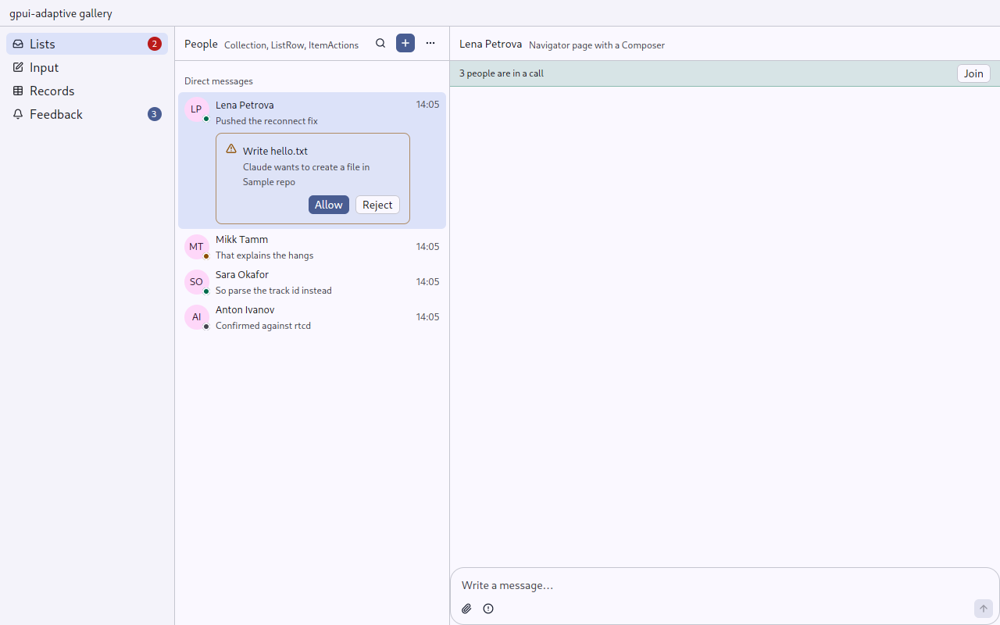
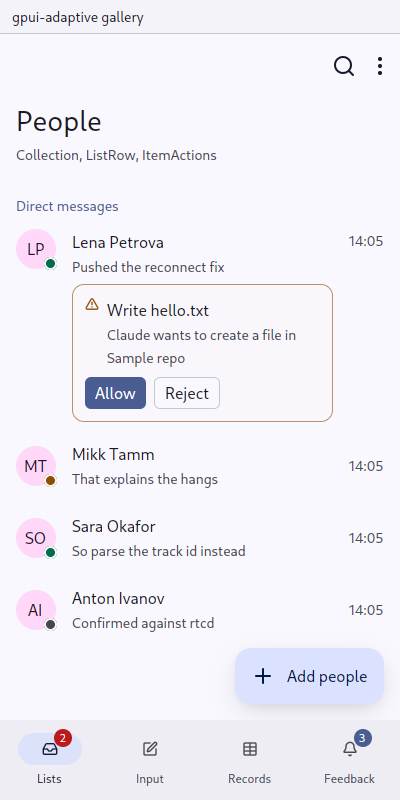

# gpui-mobile-components

`gpui-adaptive` is a design system of intents for gpui-kit applications that run on a desktop and on a phone: aiddiction, matterfast and money-manager. You write a screen once; each intent draws itself in the **pointer** skin (gpui-kit and its Design Guides) or the **touch** skin (Material 3). It is built on `gpui-adaptive-colors` and `gpui-android-glue`.

| Desktop | Phone |
|---|---|
|  |  |

- `crates/gpui-adaptive`: the design system (30 intents and foundations).
- `crates/gallery`: every intent in one window, in either skin.
- `docs/`: [the documentation](docs/README.md), one page per component, plus [testing](docs/testing.md).
- `design/`: the proposal's previews, as uploaded to Claude Design.

```sh
build-aux/cargo.sh test --offline -p gpui-adaptive
build-aux/cargo.sh run -p gallery
GALLERY_INPUT=touch GALLERY_SIZE=400x800 build-aux/cargo.sh run -p gallery
```
