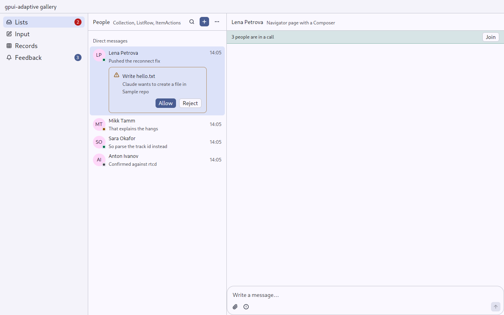
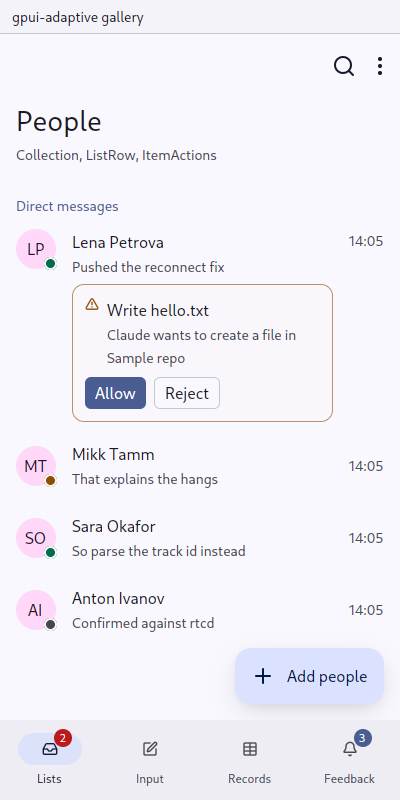

# gpui-adaptive: intents for desktop and phone

`gpui-adaptive` is a design system for gpui-kit applications that run on a desktop and on a phone: aiddiction, matterfast and money-manager. You write a screen once, against what the person is doing: a [`Screen`](components/screen.md) with [`Command`](components/command.md)s, rows of a [`Collection`](components/list.md), a [`Choice`](components/choice.md). Each intent draws itself in two skins:

- **Pointer** is gpui-kit as its Design Guides draw it: dense, hover, menus, dialogs, keyboard first.
- **Touch** is Material 3: 48 dp targets, a pressed state layer, a navigation bar, a FAB, bottom sheets and gestures.

| Desktop | Phone |
|---|---|
|  |  |

## How a frame chooses its skin

[`Env`](components/env.md) answers two questions:

| Axis | Values | Decided by | Decides |
|---|---|---|---|
| `InputMode` | `Pointer`, `Touch` | the application's entry point, once (`gpui_adaptive::init`) | the skin, and which backend a stateful intent builds |
| `WidthClass` | `Compact` < 44 rem ≤ `Medium` < 66 rem ≤ `Expanded` | the window, every frame, in rems | layout: bar, rail or sidebar; one pane or columns; list or table |

A tablet gets columns with touch feedback. A narrow desktop window gets one pane with hover and menus.

## What it stands on

Nothing here is a new engine:

- **Colours** come from `gpui-adaptive-colors`: a Material You scheme from one seed, or a Zed theme the person wears. The intents read them through `cx.theme()`; the touch skin's extra roles come from [`Palette`](components/palette.md), which falls back to the theme while a Zed theme is worn. An application reads them by role, for its skin, with `cx.colors()` ([Primitives](components/primitives.md)).
- **Phone plumbing** comes from `gpui-android-glue`: back (layers, predictive back, swipe back), the keyboard (insets, purpose, raise on tap) and the system bars. See [Insets](components/insets.md).
- **Behaviour** is gpui-kit's wherever it has it: `Select`, `Dialog`, `Notification`, `Input`, `Calendar`, `ColorPicker`, `Switch`, `Checkbox`, `Spinner`, `Progress`, `Skeleton`, the charts.

## Setup

```rust
gpui_kit::application().with_assets(gpui_kit::assets::Assets).run(|cx| {
    gpui_kit::init(cx);
    gpui_adaptive_colors::init(Options::new(Color::from_u32(0x0b57d0)), cx);
    gpui_android_glue::init(cx);                 // `launch::run` does it on Android
    gpui_adaptive::init(InputMode::Pointer, cx); // InputMode::Touch from android_main
    // open the window; its root view draws an AppFrame
});
```

## The components

**Foundations**
- [Env](components/env.md): `InputMode`, `WidthClass`, `Env::of`
- [Scale](components/scale.md): lengths and durations of each skin
- [Palette](components/palette.md): Material roles that survive a Zed theme
- [Insets](components/insets.md): status bar, navigation bar, keyboard
- [AppFrame](components/app-frame.md): the window's frame and its layers
- [Primitives](components/primitives.md): colours by role, room, icons, text, surfaces, pressables, scrolls: what an application builds its own parts from

**Structure**
- [Destinations](components/destinations.md): sections as a bar, rail or sidebar
- [Screen](components/screen.md): a page with a title and commands
- [Navigator](components/navigator.md): up to three columns or a stack, with predictive back and swipe back
- [Sheet](components/sheet.md): a bottom sheet or a dialog
- [Dock](components/dock.md): something that outlives the page
- [Stack](components/stack.md): the parts of a page in a centred column

**Actions**
- [Command](components/command.md): one action, many entry points
- [ItemActions](components/item-actions.md): hover bar and context menu, or long press
- [Menu](components/menu.md): commands behind a button, or at a point
- [Popup](components/popup.md): something small beside what opened it
- [Confirm](components/confirm.md): a question before something irreversible
- [Ask](components/ask.md): a question with a few answers, in the flow or in a dialog
- [Notice](components/notice.md): a toast or a snackbar, with Undo

**Input**
- [TextField](components/text-field.md): text and amounts, with purpose and errors
- [Form](components/form.md): fields with one commitment
- [Choice](components/choice.md): one of a known list
- [Lookup](components/lookup.md): one or several from a directory
- [Segments](components/segments.md): two to four exclusive modes
- [Toggle](components/toggle.md): on or off
- [DateField](components/date-field.md): a date, typed or picked
- [Composer](components/composer.md): writing a message, with suggestions
- [Setting and Swatches](components/setting.md): a settings page
- [Chips](components/chips.md): what a view is narrowed to, any number at once
- [ColorField](components/color-field.md): a colour the person picks

**Content**
- [ListRow, SectionHeader, Collection](components/list.md)
- [Records](components/records.md): a table or a list
- [Feed, Message, Fold](components/feed.md): a conversation as it is read
- [Code](components/code.md): text a machine wrote

**Feedback**
- [Banner](components/banner.md): a standing state of the page
- [Busy and Skeleton](components/busy.md): work under way
- [Empty](components/empty.md): nothing yet, and what to do
- [Note](components/note.md): a sentence the page says
- [Avatar and Count](components/identity.md): who, and how many

## Rules for feature code

1. Do not call gpui-kit's components. What no intent is, build from the [primitives](components/primitives.md); an application can check it with clippy's `disallowed-methods`/`disallowed-types`.
1. Do not ask for the platform. `Env::of(window, cx).is_touch()` is the one escape hatch, and every use of it in a feature is a missing intent.
2. Give repeated things stable ids from the domain (`("channel", id)`), never positions.
3. Model each command once, as a [`Command`](components/command.md). Its button, menu item, FAB and key binding then cannot disagree.
4. Keep every way of input: typing a date as well as picking it, a shortcut as well as a button, a menu as well as a gesture.
5. Test each screen in both skins (see [Testing](testing.md)).

## What stays in the applications

Some parts serve one application. It builds them itself, from the intents and the [primitives](components/primitives.md), not from gpui-kit:

| Part | Application | Built from |
|---|---|---|
| An agent's steps and plan (`ui/work.rs`) | aiddiction | `surface(Card)`, `pressable`, `Text`, `Icon`, `spinner`, `Meter`; inside a [Feed](components/feed.md) and on the [Composer](components/composer.md) |
| An edit's diff (`ui/work.rs`) | aiddiction | `surface(Well)`, `Text::mono`, the tones of `cx.colors()` |
| Task board (`ui/board.rs`) | aiddiction | `surface(Panel)`/`surface(Card)`, `scroll_x`, [ItemActions](components/item-actions.md); [Route](components/navigator.md)`::scrolls_sideways` so swipe back does not take the board's direction |
| Diff review | aiddiction | `diffreview-ui`, a view of its own embedded in a [Screen](components/screen.md) |
| Charts | money-manager | `gpui_adaptive::chart` painted with `cx.colors().chart` and the categories' colours; [Chips](components/chips.md) for the categories, [Segments](components/segments.md) for the period, `surface(Card)` and `Tile`s for the shares written out |
| A record's grid of categories | money-manager | `key_pressable` cells with a `Tile` and `Text`, under a `Labelled` in a [Form](components/form.md) |
| A conversation's feed and its messages | matterfast | gpui `list` with `list_scrollbar`, `Markdown` with its own plugins (custom emoji, mentions) and `on_link_menu` → [Menu](components/menu.md)`::open_at`; hover bar of `pressable`s and [Popup](components/popup.md)s; a long press's [Sheet](components/sheet.md) |
| The composers, the quick switcher, the title bar's search | matterfast | [TextField](components/text-field.md) with `on_key` driving its own completion list, `on_paste`, the cursor and the selection |
| An integration's buttons and selects on a card | matterfast | [Command](components/command.md) buttons; the integration's own colour as text on a wash of itself (a `div` with tokens); [Menu](components/menu.md)`::choice` |
| The call dock, the lightbox, the emoji picker | matterfast | `pressable`, `tooltip`, [Popup](components/popup.md), [Sheet](components/sheet.md), [Avatar](components/identity.md) |

## Not done yet

These are general, and belong here:

- Swipe actions on rows, and selection mode (a long press entering multi-select).
- A ripple from the touch point. The touch skin currently uses Material's pressed state layer.
