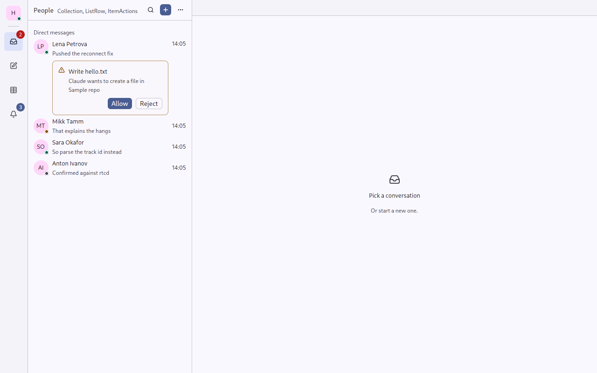
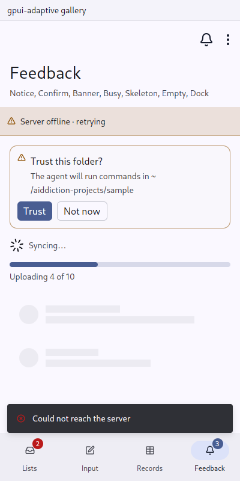

# Ask: a question with a few answers, where it arises

`gpui_adaptive::ask` · [index](../README.md)

`Ask` is for questions like an agent asking to write a file (aiddiction's permission requests, in the conversation and in the inbox row), a bot's message with buttons (matterfast's interactive messages), or "Trust this folder?".

Unlike [Confirm](confirm.md), an Ask does not stop the page. It is a card in the flow, answered when the person gets to it. `Ask::open` asks the same question in a dialog instead, for a question that must be answered before going on. Back closes that dialog without an answer.

| | Pointer | Touch |
|---|---|---|
| card | a warning-tinted card: icon, question, detail, small answer buttons at the end | the same card with answers a finger's height, wrapping onto more lines |
| `open` | a gpui-kit dialog through `back::open_dialog`, the answers in its footer | the same, with large buttons |

Answers are [Commands](command.md): `primary()` is filled, `destructive()` uses the danger colour, the rest are outlined. An answer in a dialog runs after the dialog has closed.

| In a row (desktop) | On a page (phone) |
|---|---|
|  |  |

## API

```rust
// in the conversation, or as a ListRow's body in the inbox
Ask::new(("permission", request.id), "Write hello.txt")
    .detail("Claude wants to create a file in Sample repo")
    .answer(Command::new(("allow", request.id), "Allow").primary().on_trigger(allow))
    .answer(Command::new(("reject", request.id), "Reject").on_trigger(reject))

// must be answered first
Ask::new("trust", "Trust this folder?")
    .detail("The agent will run commands in it.")
    .tone(Tone::Info)
    .answer(Command::new("trust-yes", "Trust").primary().on_trigger(trust))
    .answer(Command::new("trust-no", "Not now"))
    .open(window, cx);
```

The tone is `Warning` by default, for asking for permission; use `Info` for an ordinary question. Each answer's element id is its command's id.

## Tests

`tests/ui.rs`:
- `an_answer_inside_a_row_does_not_open_the_row`, in both skins.
- `a_question_asked_in_a_dialog_closes_with_its_answer`, in both skins: the dialog opens, the answer closes it, then runs.
