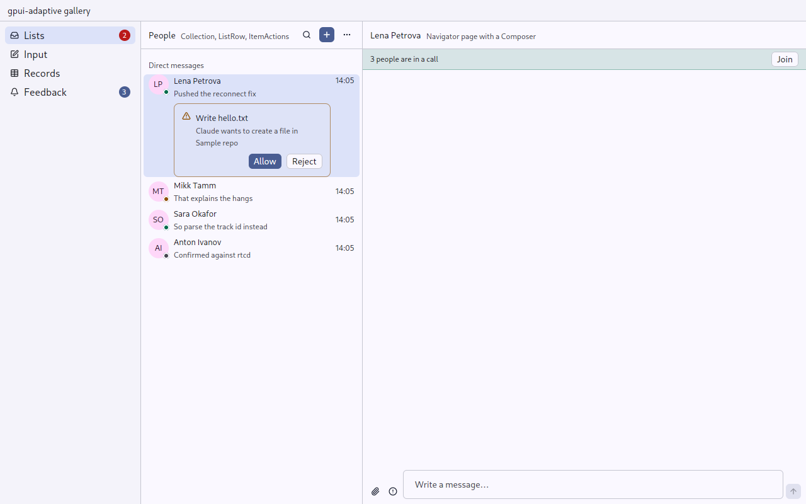
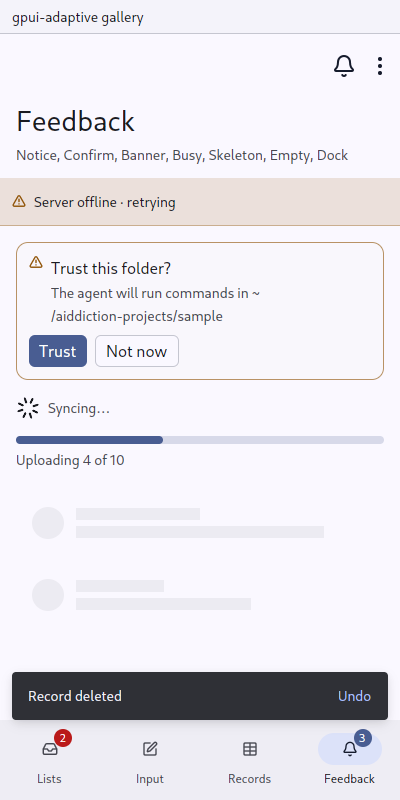

# Banner: a standing state of the page

`gpui_adaptive::banner` · [index](../README.md)

A banner sits under the page's bar for as long as a state lasts: "3 people are in a call — Join", "Server offline · retrying", "Sign in to continue". Unlike a [Notice](notice.md), it does not go away by itself.

| Pointer | Touch |
|---|---|
| a strip the height of a control, the action as a small button | a strip a finger's height, the action as a text button |

The tint is the tone's colour from the theme (`info`, `success`, `warning`, `danger`), at 14% behind the text and 35% for the border.

| Pointer | Touch |
|---|---|
|  |  |

## API

```rust
Screen::new(..).banner(call.map(|call| {
    Banner::new(("call", call.channel), format!("{} people are in a call", call.count))
        .tone(Tone::Success)
        .icon(IconName::Phone)
        .extra(faces(call))
        .action(Command::new(("join", call.channel), "Join").action(JoinCall))
}))
```

Keep tones semantic and scarce: `Info` for neutral information, the others only for what they mean.
