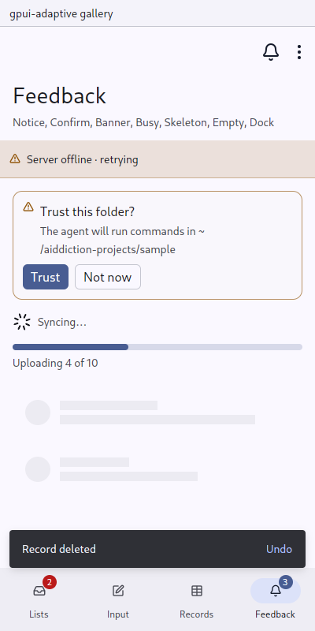

# Busy and Skeleton: work under way

`gpui_adaptive::busy` · [index](../README.md)

- `Busy::new(id)` is work of unknown length: gpui-kit's `Spinner`, small on a pointer and large on touch, with an optional label.
- `Busy::new(id).fraction(0.4)` is work 40% done: gpui-kit's `Progress` bar with its label under it.
- `Skeleton::rows(n)` is placeholder rows in the shape of a list about to load (gpui-kit `Skeleton`). `.with_avatar()` adds a circle before each row.



## API

```rust
Busy::new("sync").label("Syncing…")
Busy::new("upload").fraction(sent as f32 / total as f32).label(format!("Uploading {sent} of {total}"))
if loading { Skeleton::rows(6).with_avatar().into_any_element() } else { list.into_any_element() }
```

## Rules

- A page that loads shows skeleton rows in the shape of what is coming, not a spinner in the middle of nothing.
- An inline spinner sits beside what is busy, such as a banner or a button's `loading(true)`.
- Long work that the person waits on shows a fraction when one is known.
