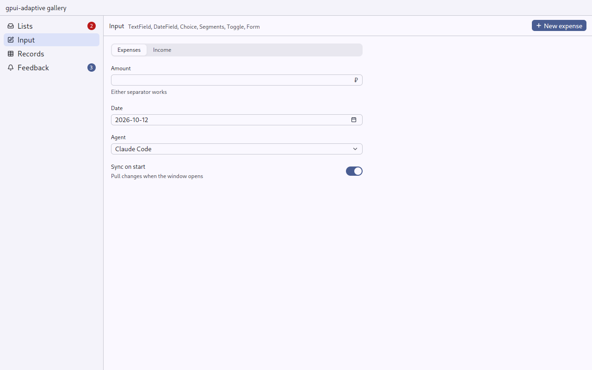
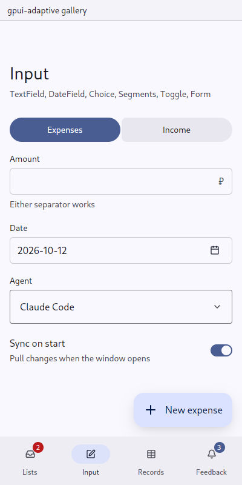

# Choice: one option from a known list

`gpui_adaptive::choice` · [index](../README.md)

Use `Choice` for a project, an agent, a category, an account or a theme.

| Pointer | Touch |
|---|---|
| gpui-kit `Select`: keyboard navigation and type-ahead, with a search field from 8 options on (`SEARCHABLE_FROM`) | a field a finger presses, which opens the options as rows of a [sheet](sheet.md) with the chosen one marked; choosing one closes it |

| Pointer | Touch |
|---|---|
|  |  |

## API

```rust
// in new():
let options = agents.iter().map(|a| ChoiceOption::new(a.id.clone(), a.name.clone()).detail(a.vendor.clone())).collect();
let agent = cx.new(|cx| ChoiceState::new(options, Some("claude".into()), window, cx));
cx.subscribe(&agent, |this, _, ChoiceEvent::Change(key), cx| this.agent_changed(key, cx));

// in render():
Choice::new(&self.agent).label("Agent").placeholder("No agents").id("agent")

// from the owner, without an event:
agent.update(cx, |c, cx| c.set_selected(Some("codex".into()), window, cx));
```

The backend (gpui-kit `Select` or the touch sheet) is chosen once, in `ChoiceState::new`, from the application's input mode. The state owns the value: it emits `ChoiceEvent::Change(key)` once for each choice the person makes, and never for `set_selected`.

- `ChoiceState::searchable(..)` gives the pointer's select a search field however few the options: for a list that grows with what the person has (aiddiction's projects and agents), so that many are as quick to pick as two.
- `set_options(options, selected, window, cx)` puts other options in place, without an event: the agents of the project chosen in the field above.

## When not to use

- 2–4 exclusive modes that are all visible at once: use [Segments](segments.md).
- A directory too large to list (people, channels): use [Lookup](lookup.md).

## Tests

`tests/ui.rs`: `on_a_phone_a_choice_opens_a_sheet_and_choosing_closes_it` presses the field, waits for the sheet, presses an option, and checks both the event and the state.
