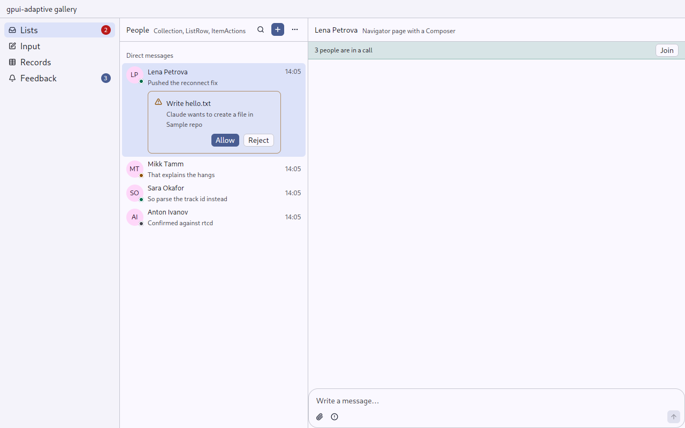
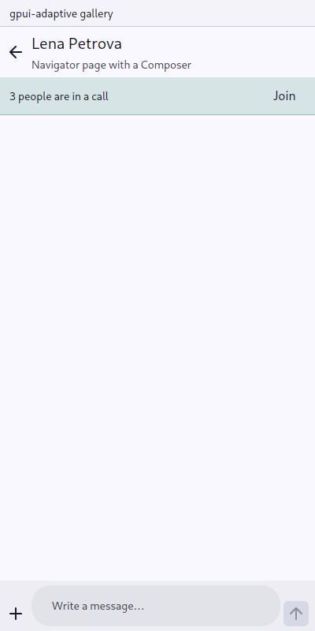

# Composer: writing a message

`gpui_adaptive::composer` · [index](../README.md)

The composer writes a message to someone in a channel (matterfast) or to an agent (aiddiction). It is a text area that grows with what is written, up to eight lines, with tools around it and send. Things can stand above it: what is replied to, an agent's plan.

| | Pointer | Touch |
|---|---|---|
| Layout | a card: what stands above, the field, then the tools, the hint and send | the same card, without the hint |
| Tools | icon buttons under the field; a menu tool shows what is chosen and opens a menu | the same buttons; a menu tool opens a [sheet](sheet.md) of its options |
| Working | send is a stop button | the same |
| Hint | a line about the keys beside the tools | not shown |
| Enter | sends; Shift+Enter breaks the line | breaks the line; the send button sends, as on a phone |
| Keyboard | — | `Purpose::Message`: capitals and corrections; the composer rides on it (the page pads by `Insets::typing()`) |
| Send | disabled while the draft is empty, or while the other side cannot take a message (`can_send(false)`) | the same |

| Pointer | Touch |
|---|---|
|  |  |

## API

```rust
let composer = cx.new(|cx| ComposerState::new("Write a message…", window, cx));
cx.subscribe_in(&composer, window, |this, composer, event: &ComposerEvent, window, cx| {
    if *event == ComposerEvent::Send {
        let text = composer.read(cx).text(cx);
        this.post(text, cx);
        composer.update(cx, |c, cx| c.clear(window, cx));
    }
});

Composer::new(&self.composer)
    .above(reply_to_line)
    .tool(Command::new("attach", "Attach files").icon(Lucide::Paperclip).action(Attach))
    .tool(Command::new("priority", "Priority").icon(IconName::CircleAlert).action(SetPriority))
```

An agent's composer in aiddiction:

```rust
Composer::new(&self.composer)
    .above(plan)                                  // each `above` is one band, top to bottom
    .suggestions(matching_commands)
    .menu(Command::new("mode", "Ask first").icon(IconName::Bot), modes, Some(current_mode_id))
    .stop(busy.then(|| Command::new("stop", "Stop the agent's turn").on_trigger(cancel)))
    .can_send(connected)
    .hint("/ for commands · Shift+Enter for a new line")
```

The draft belongs to the owner: `text()` reads it, `set_text()` replaces it (a picked command) and puts the cursor at its end, and `clear()` empties it after sending. `ComposerEvent::Change` comes as it is typed. `suggestions` puts what completes the draft in a band over the field, one pressable row each: the agent's commands matching "/re", the people matching "@an". Picking one runs its handler, which usually puts it in the draft:

```rust
Suggestion::new(("command", name), "/review", move |window, cx| {
    composer.update(cx, |c, cx| c.set_text("/review ", window, cx));
})
.detail("Review the changes")
.code()   // typed as it is: monospaced
```

## Tests

`tests/ui.rs`: `a_working_composer_stops_instead_of_sending` and `a_suggestion_over_the_composer_is_picked_by_a_press`, both in both skins.
