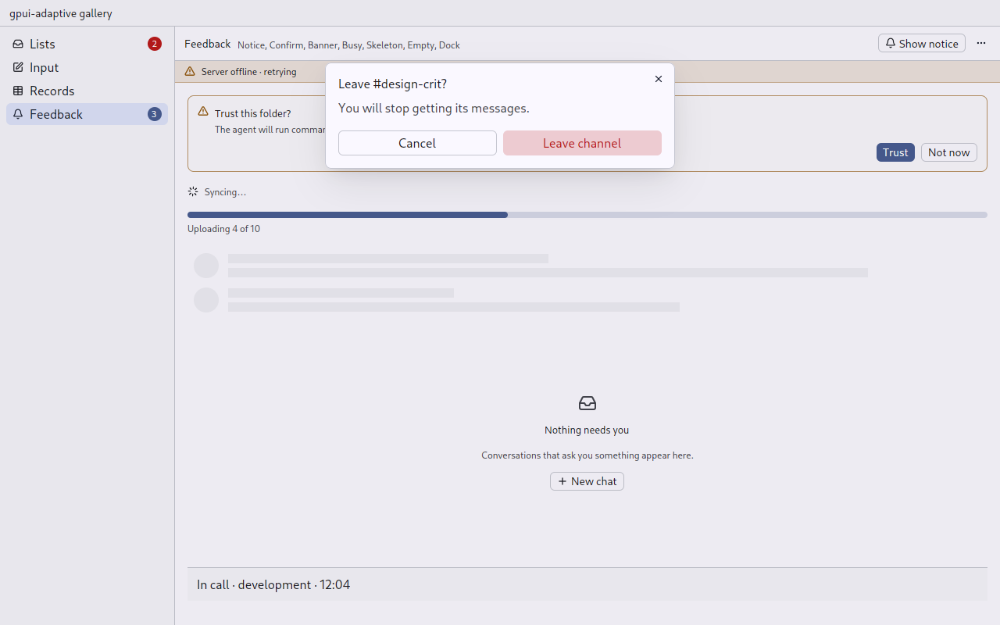

# Confirm: a question before something that cannot be undone

`gpui_adaptive::confirm` · [index](../README.md)

Use `Confirm` for leaving a channel, archiving it, removing a member, or deleting an account. Both skins open a gpui-kit dialog through `gpui_android_glue::back::open_dialog`, so the phone's back closes it. The touch skin gives the buttons Material's height and makes Cancel a text button.



## API

```rust
Confirm::new("leave", "Leave #design-crit?")
    .body("You will stop getting its messages. A private channel can only be rejoined by invitation.")
    .confirm(Command::new("leave-yes", "Leave channel").destructive().on_trigger(leave))
    .open(window, cx);
```

The confirming command runs after the dialog has closed and the focus is back, so an action it dispatches reaches the page.

## Rules

- **Name the action.** The button says "Leave channel", never "OK". The title is the question.
- **A destructive confirmation uses the danger colour.** Escape cancels.
- **A question with several answers that should not stop the page** (permission requests, a bot's buttons) is an [Ask](ask.md).
- **Do not ask about what can be undone.** Do it, and offer "Undo" in a [Notice](notice.md). The Coding Guides list "confirmation dialogs for reversible, low-risk actions" as a failure mode.

## Replaces

matterfast `dialogs/confirm.rs`, `confirm_leave.rs`, `confirm_archive.rs`, `confirm_remove_member.rs`.
