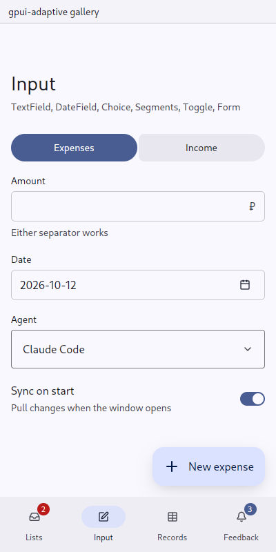

# DateField: a date, typed or picked

`gpui_adaptive::date_field` · [index](../README.md)

The field is a line of text first (money-manager's `date_field.rs`). A date is four or eight key presses, a calendar a dozen taps. The calendar is one button away for when the day of the week is what is known. The two are one value: typing a date moves the calendar to it, and picking a day writes it into the field.

Accepted forms (short ones are read against the field's date, or today):

| Typed | Read as |
|---|---|
| `2026-10-12` | 12 October 2026 |
| `12.10.2026`, `12/10/2026`, `12.10.26` | 12 October 2026 |
| `4.10` | 4 October, this year |
| `7` | the 7th of this month |

| Pointer | Touch |
|---|---|
| the calendar (gpui-kit `Calendar`) opens under the field | the calendar opens in a [sheet](sheet.md); picking a day closes it; the field's keyboard is digits |



## API

```rust
let date = cx.new(|cx| DateFieldState::new(Some(record.date), window, cx));
cx.subscribe(&date, |this, _, DateFieldEvent::Change(day), cx| this.date_changed(*day, cx));

DateField::new(&self.date).label("Date")
date.update(cx, |d, cx| d.set_date(day, window, cx));   // from the owner, without an event
date.read(cx).date();                                    // Option<NaiveDate>
```

An event is emitted only when a whole date is typed or picked, and only when it differs from the current one.

## Tests

`date_field::tests` covers the full and short forms, two-digit years, impossible dates (`31.02`) and words.
