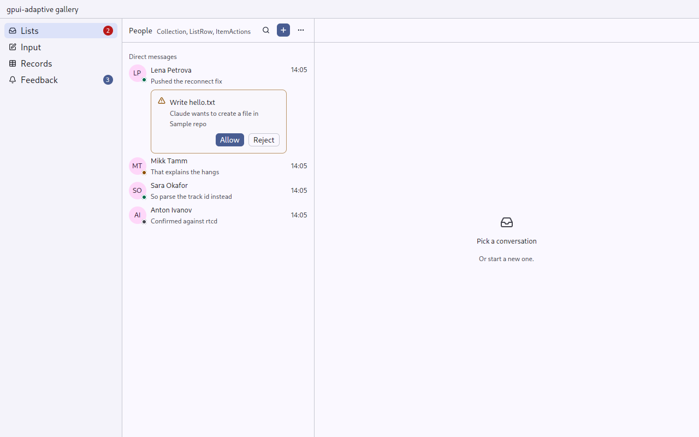
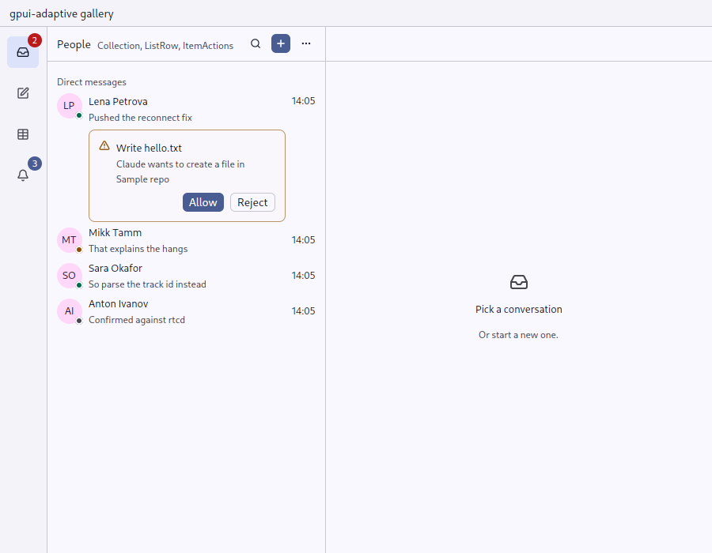
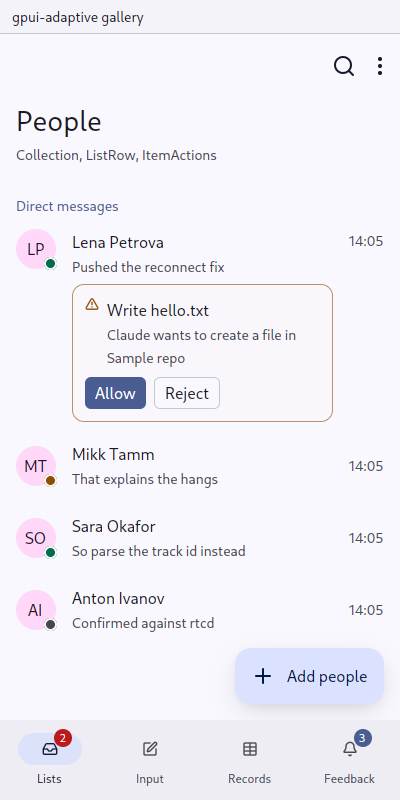
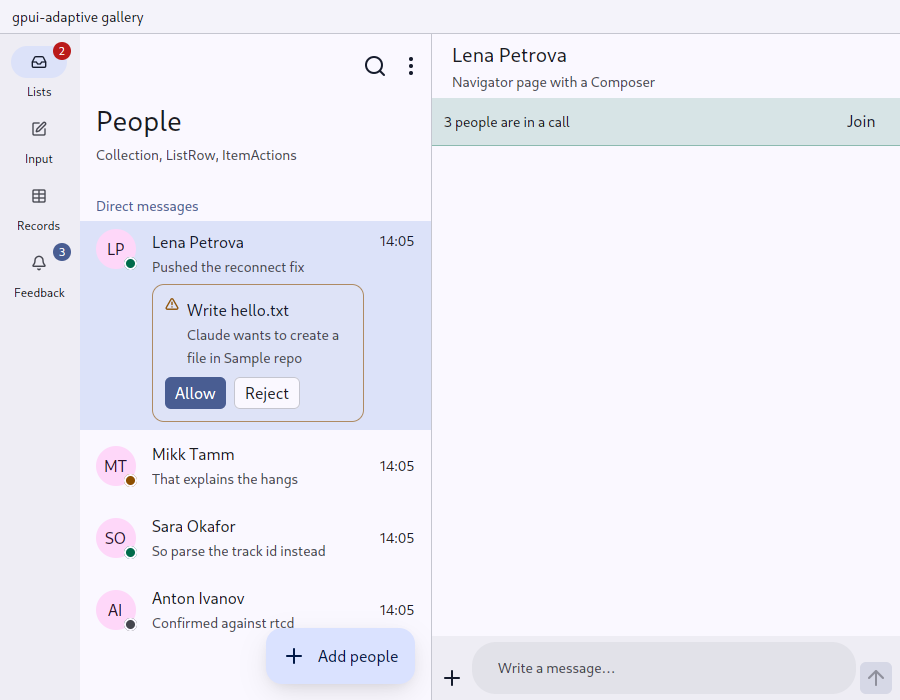
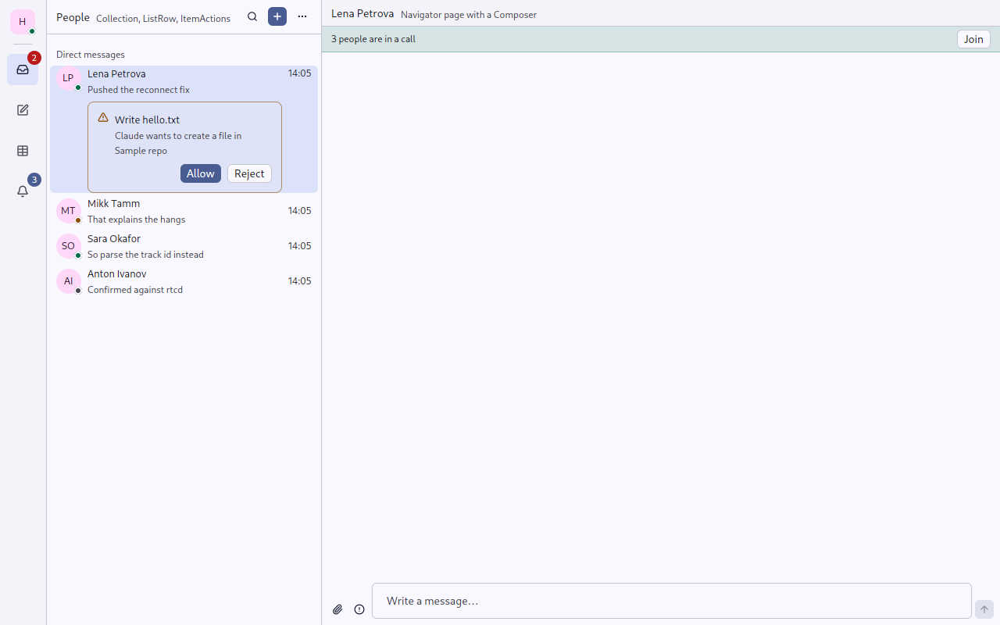

# Destinations: the application's sections

`gpui_adaptive::destinations` · [index](../README.md)

`Destinations` holds the top-level sections (Inbox, Projects, Settings; Records, Categories, Charts), with a count of what waits in each, and the page of the selected one.

| Width | Pointer | Touch |
|---|---|---|
| Compact | a bar along the bottom | Material navigation bar: a pill on the selected icon, labels, counts |
| Medium | an icon rail with tooltips | a navigation rail; the primary command on top |
| Expanded | a sidebar with icons, labels and counts; the header (account or server switcher) on top; pinned items at the bottom | a navigation rail with labels |

| Pointer, Expanded | Pointer, Medium | Touch, Compact | Touch, Medium |
|---|---|---|---|
|  |  |  |  |

The navigation bar belongs to a section's first page: it is the page's *foot* (`Destinations::bar(window, cx)`, given to `Navigator::bar`). Because the page draws it, the bar goes with the page — a gesture of back reveals it together with the page it goes to, rather than appearing after the gesture has ended — and it is never laid over a deeper page, which gets the whole height and back. With the bar, the bar keeps the system's navigation-bar room and goes under the keyboard while the page rises above it; a deeper page keeps that room itself (see [Insets](insets.md)). Use it inside an `AppFrame::edge_to_edge(true)`.

## API

```rust
let sections = Destinations::new("sections", selected_key)
    .header(server_switcher)                       // sidebar only
    .primary(Command::new("new-chat", "New chat").icon(IconName::Plus).action(NewChat))
    .destination(Destination::new("inbox", "Inbox", IconName::Inbox).count(waiting, true))
    .destination(Destination::new("projects", "Projects", IconName::Folder))
    .destination(Destination::new("settings", "Settings", IconName::Settings).pinned())
    .on_select(move |key, _, cx| navigator.update(cx, |n, cx| n.replace_root(route_for(key), cx)));

// The bar is the page's foot: the compact window's navigation bar, drawn by
// the navigator under the section's first page and moving with it.
let bar = sections.bar(window, cx);
let pages = Navigator::new("pages", &navigator, render_page).bar(bar);
AppFrame::new("App").edge_to_edge(true).child(sections.content(pages))
```

- `prefer_rail(true)`: a rail even where a sidebar fits. This is for an application whose sections' pages bring their own list column, as aiddiction's inbox, projects and settings do; a sidebar would be a second list beside it.
- `header(..)` heads the sidebar or the rail. In a rail it should be no wider than an item, for example a square [Avatar](identity.md) for the server.
- `count(n, urgent)`: `urgent` (danger colour) only for what waits on the person: mentions, a question from an agent. Other counts use the primary colour.
- The key is the section's stable name. Each destination's element id is its key, so tests and scenarios can press `"settings"`.
- On a compact window the page's [Screen](screen.md) draws the primary command as its FAB; give it to the root page's screen as well.
- The navigation bar along the bottom is a cached view: GPUI reuses it from the previous frame while a page scrolls above it, and draws it again only when a label, a count, the selection or the colours change. A press always reaches the latest `on_select`.

| aiddiction's desktop: `prefer_rail` + `header`, pages in the title bar |
|---|
|  |

## Built on

gpui-kit theme roles `sidebar*` and `list_hover`, [Palette](palette.md) for the touch containers, [Count](identity.md), `Tooltip`.

## Replaces

aiddiction `ui/nav.rs` (`render_rail`, `render_tabs`, `render_fab`); money-manager's sidebar and bottom bar in `workspace/render.rs`.

## Tests

`tests/ui.rs`: `choosing_a_destination_replaces_the_stack` covers both skins (desktop sidebar, phone navigation bar); `a_rail_can_be_preferred_on_a_desktop_and_carries_the_header`.
