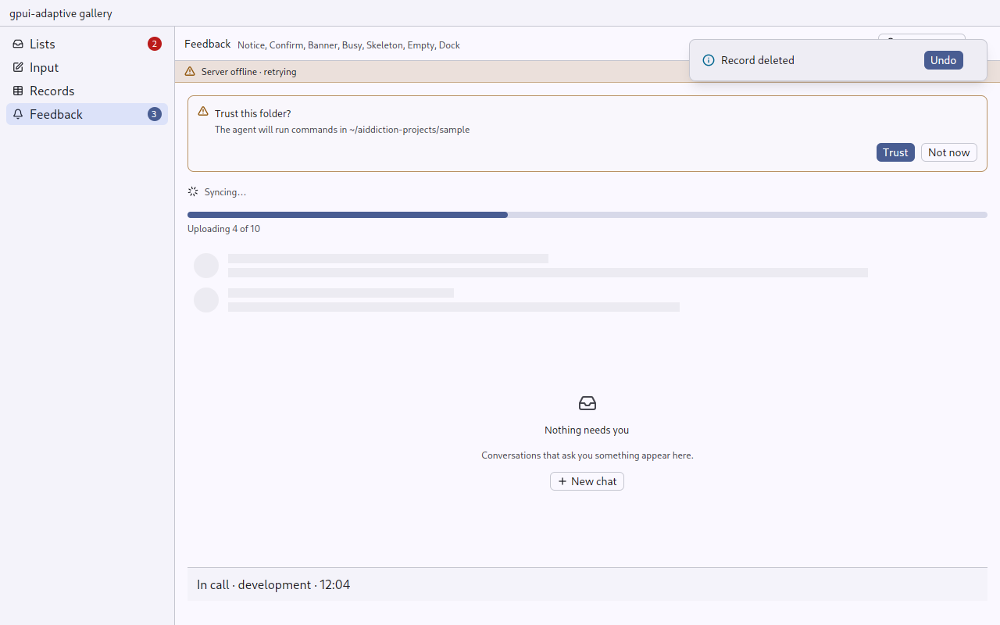

# Dock: something that outlives the page

`gpui_adaptive::dock` · [index](../README.md)

A dock is for a call (matterfast's call dock), a sync in progress, or music playing: something whose controls cannot live in the page it started on, because it goes on after that page is left.

| Window | Place (`Dock::place(window)`) | Look |
|---|---|---|
| Medium, Expanded | `DockPlace::Column`: at the foot of the navigation column, under the sidebar or the list | the sidebar's colours |
| Compact | `DockPlace::Page`: across the bottom of the page, above the navigation bar | a container colour, a finger's height on touch |



## API

```rust
let dock = call.map(|call| Dock::new("call-dock").child(call_controls(call)));
match Dock::place(window) {
    DockPlace::Column => sidebar = sidebar.children(dock),
    DockPlace::Page => page = page.children(dock),
}
```

The dock draws the owner's content as given. The owner decides where it goes from `place`, because only the owner knows its columns.
