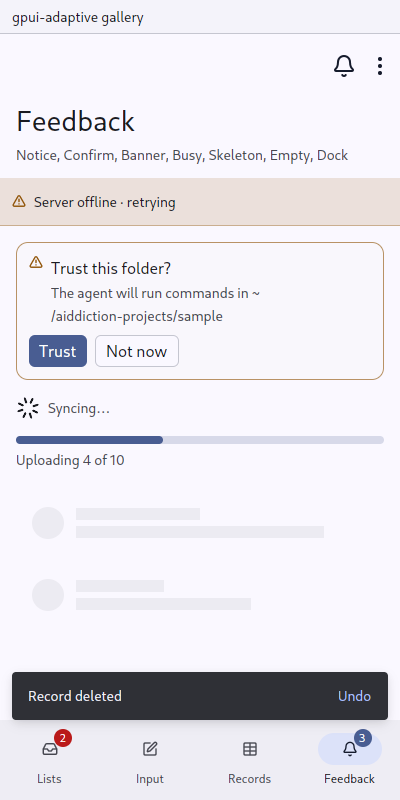

# Empty: nothing yet, and the one thing to do about it

`gpui_adaptive::empty` · [index](../README.md)

An empty state says there is nothing here yet and offers one thing to do, such as "Nothing needs you — New chat".

| Pointer | Touch |
|---|---|
| a muted icon, a line, a short sentence and a button, centred and quiet | Material's empty state: the icon on a large rounded secondary container, a title, a sentence, a button |



## API

```rust
Empty::new(IconName::Inbox, "Nothing needs you")
    .body("Conversations that ask you something appear here.")
    .action(Command::new("new-chat", "New chat").icon(IconName::Plus).action(NewChat))
```

It fills the space it is given and centres itself in it.

## Rules

- **Say what will appear here**, not that something "is empty".
- **Offer at most one action**, and only one that makes the page non-empty.
- **Search and filter results** say what was searched for in the title: "No records match ‘pharm’".
