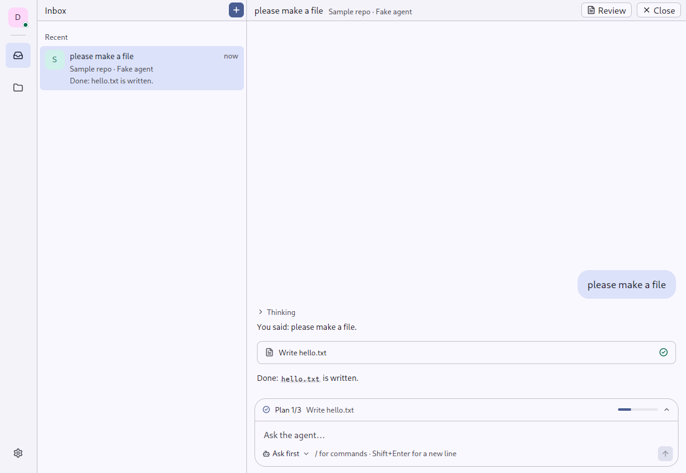
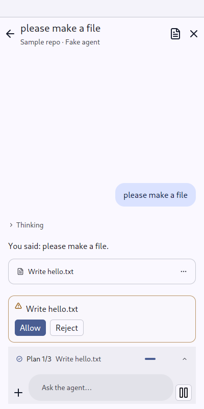

# Feed, Message, Fold: a conversation as it is read

`gpui_adaptive::feed` · [index](../README.md)

A feed is a conversation's messages, newest at the bottom: a channel in matterfast, a conversation with an agent in aiddiction. It follows what comes in until the reader scrolls away, and draws only what is on screen.

| | Pointer | Touch |
|---|---|---|
| Column | at most `READING_WIDTH` (48 rem), centred, gpui-kit's scrollbar | the same column, edge to edge on a phone |
| Your message (`Message::mine`) | a bubble at the end in the theme's `secondary` | a bubble in Material's `primary_container` |
| Theirs (`Message::theirs`) | Markdown on the page, selectable, links through `on_link` | the same |
| An aside (`Message::aside`) | a small centred line; a tone colours it | the same |
| `Fold` | a quiet line with a chevron, its content indented | the same, a finger's height |

| Pointer | Touch |
|---|---|
|  |  |

## API

```rust
// the owner keeps the state and tells it what changed, as with gpui's `list`
let list = Feed::state();
list.splice(from..shown, count - from);

Feed::new(&self.list, move |index, _, cx| {
    this.update(cx, |view, cx| view.render_entry(index, cx)).unwrap()
})
.empty(nothing_yet.then(|| Empty::new(IconName::Bot, "Fake agent in Sample repo")))

Message::mine(("message", index), text)
Message::theirs(("message", index), markdown)
    .before(Some(Fold::new(("thought", index), "Thinking").open(open).on_toggle(toggle).child(thought)))
    .on_link(|url, _, cx| open_url(url, cx))
Message::aside(("notice", index), "The agent stopped.").tone(Tone::Danger)
```

A page with a feed says `Screen::scrolls(false)`: the feed is its scroll area. What stands under the feed (questions, the [Composer](composer.md)) is the page's.

## Tests

`tests/ui.rs`: `a_fold_a_swatch_and_a_pressable_answer_a_press_in_both_skins` presses a fold in both skins.
