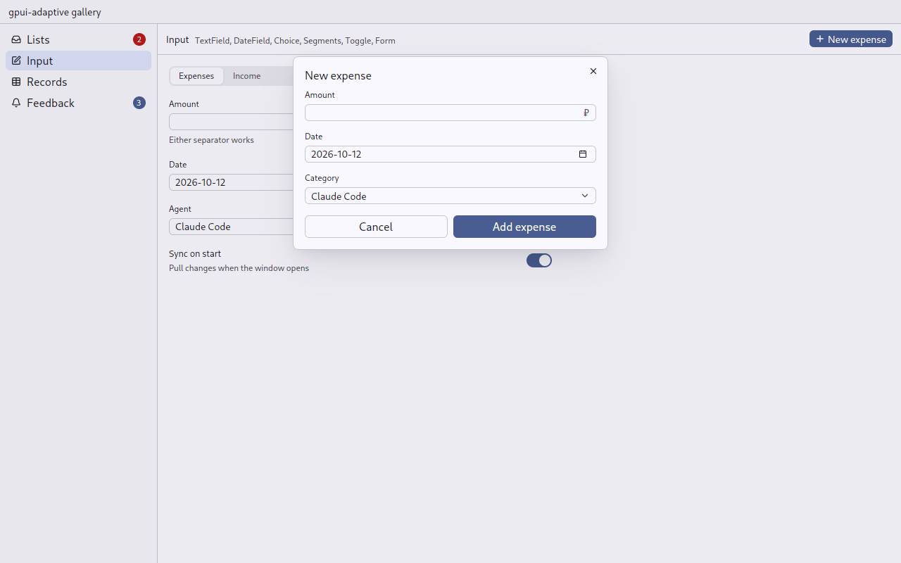
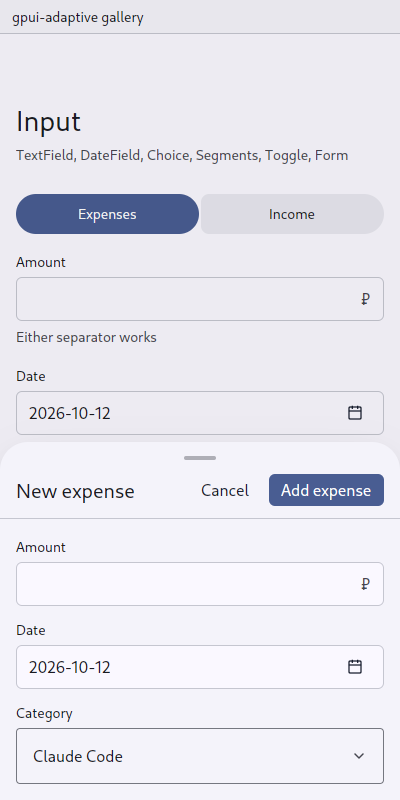

# Form: fields with one commitment

`gpui_adaptive::form` · [index](../README.md)

A form is a titled set of fields with Cancel and one commitment, such as "New expense — Add expense".

| Pointer | Touch |
|---|---|
| a gpui-kit dialog (aiddiction's `ui/forms.rs`): title, fields, Cancel and the commitment; Enter commits, Escape cancels; on a tablet the dialog moves to the top while the keyboard is up and its fields scroll | a [bottom sheet](sheet.md) (money-manager's `open_form`): the title with Cancel and the commitment beside it at the top, the fields scrolling under it, the sheet above the keyboard; the keyboard's action key in a one-line field commits; back closes it |

| Pointer | Touch |
|---|---|
|  |  |

## API

```rust
let fields = cx.new(|_| ExpenseFields { amount: self.amount.clone(), date: self.date.clone(), category: self.category.clone() });
let amount = self.amount.clone();
Form::new("New expense", fields)
    .commit("Add expense", move |window, cx| {
        let Some(value) = amount.read(cx).number(cx) else {
            amount.update(cx, |f, cx| f.set_error(Some("Type an amount"), cx));
            return false;               // the form stays open
        };
        save(value, cx);
        true                            // the form closes
    })
    .focus(first_field_focus)
    .open(window, cx);
```

The fields are the owner's own view: its [TextField](text-field.md)s, [Choice](choice.md)s and [DateField](date-field.md)s, laid out as it likes. The form therefore keeps its state wherever it is shown. Without `commit`, the form is a panel with Done.

`Form::close(window, cx)` closes the open form, dialog or sheet: for a commitment that finishes later, such as a server checked over the network before it is saved, which answers `false` and closes the form once the server has answered.

## Rules

- **Name the commitment** ("Add expense", "Create channel"), not "OK" or "Submit".
- **Keep the commitment enabled** and say what is missing, rather than leaving a dead button.
- **Put errors under their fields**, not in a notice.

## Replaces

aiddiction `ui/forms.rs`, matterfast `dialogs/forms/*`, and money-manager `bottom_sheet::open_form`.

## Fields

The owner's view lays its fields out with `Fields`: one under another, `space_m` of the [scale](scale.md) between them. What the form as a whole says ("Checking…") is a [Note](note.md) at the end.

```rust
impl Render for ServerForm {
    fn render(&mut self, _: &mut Window, _: &mut Context<Self>) -> impl IntoElement {
        Fields::new()
            .child(TextField::new(&self.name).label("Name"))
            .child(TextField::new(&self.url).label("Address"))
            .children(self.note.clone().map(Note::new))
    }
}
```

A control of the owner's own (money-manager's grid of categories, its Today and Yesterday) takes a label the way a field does with `Labelled::new("Category", grid)`.

A form opened from a form opens over it, in either skin, and closing it uncovers the first as it was: money-manager's "New…" among a record's categories.

A list inside a form (the server's folders) is a `Collection::boxed(height)`: a framed box of a fixed height that scrolls, so the form does not change size as the rows change.
