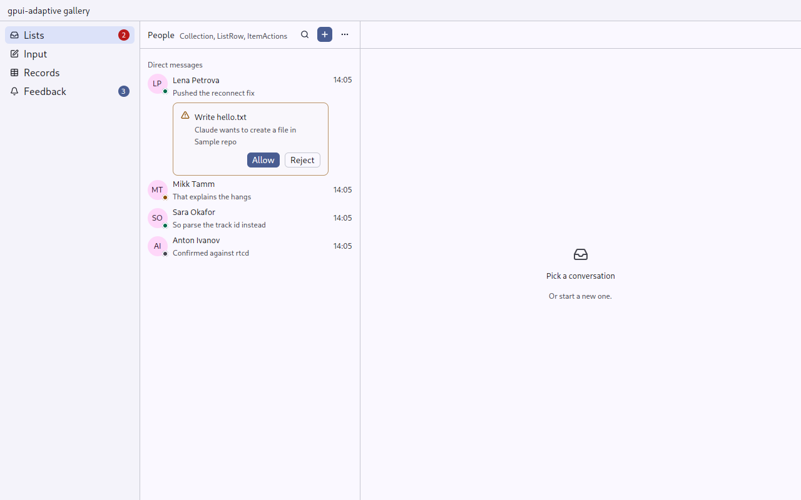

# Avatar and Count: who, and how many

`gpui_adaptive::identity` · [index](../README.md)

These are made once so that the same person looks the same in a sidebar, a feed and an inbox (matterfast's `kit.rs`).

## Avatar

An avatar is a picture, or initials on the tertiary container, with an optional presence dot. It is 2 rem on a pointer and 2.5 rem on touch unless sized. `square()` gives rounded square corners for a team, a server or a project rather than a person.

| Presence | Dot |
|---|---|
| `Online` | the theme's `success` |
| `Away` | `warning` |
| `Busy` | `danger` |
| `Offline` | `muted_foreground` |

```rust
Avatar::new(("user", user.id), user.initials())
    .picture(user.picture_url())     // impl Into<ImageSource>
    .presence(Presence::Online)
Avatar::new(("server", server.id), "H").square()
```

## Count

A count of what waits: unread messages, conversations that need you. Nothing is drawn for zero, and it shows `99+` above 99.

```rust
Count::new(unread)                         // the primary colour
Count::new(mentions).urgent(true)          // the danger colour: waits on the person
```

Keep counts semantic and scarce (Coding Guides): the danger colour is only for mentions and for something that waits on the person.


