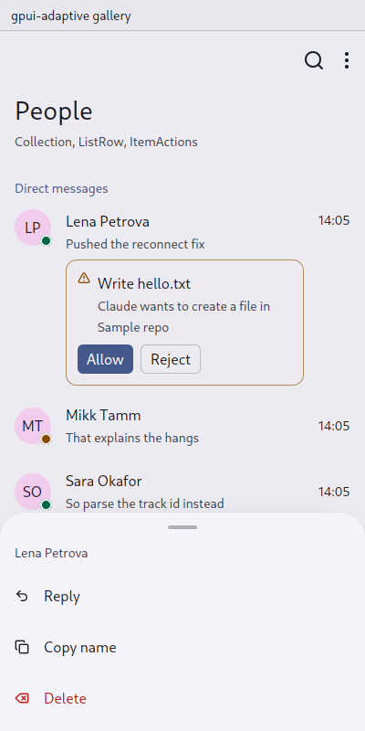

# ItemActions: what can be done to one item

`gpui_adaptive::item_actions` · [index](../README.md)

`ItemActions` holds the [commands](command.md) of one message, channel, record or task.

| Pointer | Touch |
|---|---|
| The **quick** commands appear in a small bar at the row's top right while the pointer is over it (matterfast's `hover_actions.rs`). A **right click** opens every command in a context menu with key bindings. | A finger has no hover and no right button, so a **long press** opens the commands in a [sheet](sheet.md): quick ones first, then the rest, destructive last (matterfast's `post_sheet.rs`). The press is taken on its way down, ahead of text selection and of the row's own tap. |



## API

```rust
ListRow::new(("channel", channel.id), channel.name())
    .actions(
        ItemActions::new()
            .title(channel.name())
            .quick(Command::new(("mute", channel.id), "Mute").icon(IconName::BellOff).on_trigger(..))
            .command(Command::new(("move", channel.id), "Move to…").on_trigger(..))
            .command(Command::new(("leave", channel.id), "Leave").destructive().on_trigger(..)),
    )
```

[ListRow](list.md) attaches them itself. For any other pressable surface, use `actions.attach(stateful_div, env, cx)` (or `actions.wrap(stateful_div, cx)` where there is no window at hand), or `actions.open_sheet(window, cx)` to open the sheet directly. `.inline()` is for an item among others on a line, a folder's tab in a strip: it keeps its own width instead of its row's.

## Rules

- Give quick commands an icon; the hover bar shows icons only.
- A press on a command in the hover bar is the command's: it does not open the item under it (`a_command_in_the_hover_bar_does_not_open_the_item`).
- Copying the text of a message belongs among the commands on touch. The long press is taken before text selection, as matterfast does.

## Not done yet

Swipe actions on rows (Material's swipe to archive or delete) and selection mode (long press entering multi-select) are in the proposal but not implemented.
