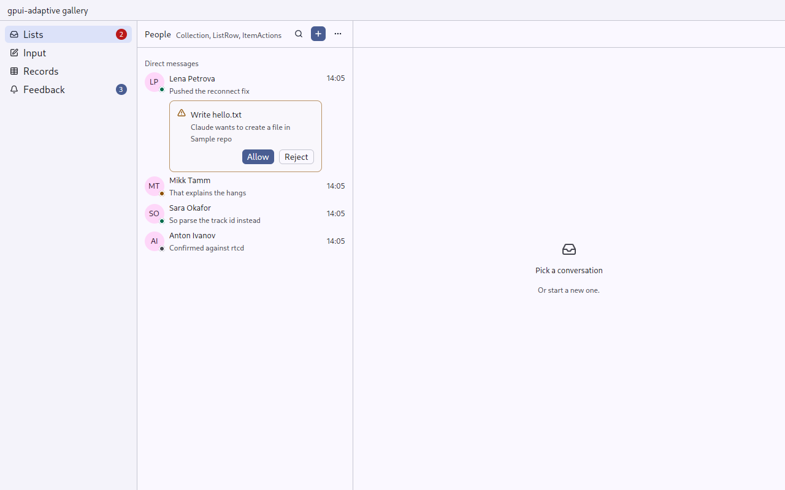
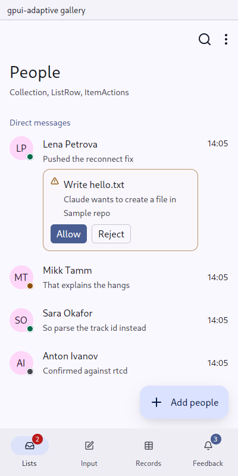

# ListRow, SectionHeader, Collection

`gpui_adaptive::list` · [index](../README.md)

These are lists of things: conversations, channels, records, projects, settings.

| | Pointer | Touch |
|---|---|---|
| `ListRow` | dense: 1.75 rem, or 2.75 rem with a second line; the theme's hover; rounded | Material list item: 56 dp, or 72 dp with a second line; the pressed state layer |
| selected | the sidebar's accent | the secondary container |
| commands | hover bar and right click ([ItemActions](item-actions.md)) | long press → sheet |
| `SectionHeader` | small, semibold, muted | small, semibold, in the primary colour |
| `Collection` | rows with a 1 px gap and padding | rows edge to edge |

| Pointer | Touch |
|---|---|
|  |  |

## API

```rust
Collection::new("channels")
    .child(SectionHeader::new("Favourites"))
    .children(favourites.iter().map(|c| {
        ListRow::new(("channel", c.id), c.name.clone())
            .leading(Avatar::new(("channel-face", c.id), c.initials()))
            .subtitle(c.last_message.clone())
            .trailing(Count::new(c.unread).urgent(c.mentioned))
            .unread(c.unread > 0)
            .muted(c.muted)
            .selected(Some(c.id) == open)
            .actions(channel_actions(c))
            .on_activate(move |window, cx| open_channel(c.id, window, cx))
    }))
```

- `.body(element)` puts something to act on inside the row, under its text: the answers to an agent's question in an inbox ([Ask](ask.md)), Accept and Decline for an invitation. A press in the body is its own and does not open the row. With a body, the leading and trailing parts align to the top.
- Inside a [Screen](screen.md) the screen scrolls. A collection that is a column of its own says `.scrolls(true)`; on touch its scroll is locked to its axis.
- Every row needs a stable id from the domain, never a position: positions move when rows are inserted.
- Thousands of rows belong in gpui-kit's `v_virtual_list`, with `ListRow`s as its items.

## States

| State | Look |
|---|---|
| `unread` | bold title |
| `muted` | dimmed |
| `selected` | container colour |
| loading | [Skeleton](busy.md) rows |
| empty | [Empty](empty.md) |

## Tests

`tests/ui.rs` presses rows in both skins in the navigator tests. `an_answer_inside_a_row_does_not_open_the_row` checks, in both skins, that a press on an answer runs the answer only, and a press on the row's text opens it.
