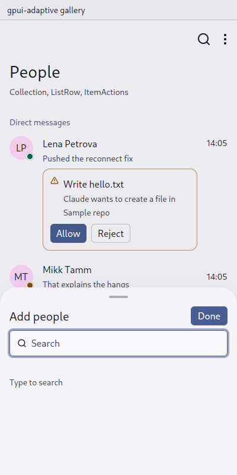

# Lookup: from a directory too large to list

`gpui_adaptive::lookup` · [index](../README.md)

Use `Lookup` to pick people or channels, one or several (matterfast's `dialogs/picker.rs`). The owner answers every query: it subscribes to `LookupEvent::Query`, searches on the server or in a cache, and hands the results back with `set_results`. What has been chosen stays above the results as chips, each with a cross to take it back.

| Pointer | Touch |
|---|---|
| a dialog: the search field, the chips, the results; Done commits | a bottom sheet: the field first and focused, above the keyboard; back cancels |

A single choice commits as soon as an option is pressed. With `multiple`, options toggle and Done commits.



## API

```rust
let lookup = cx.new(|cx| LookupState::new("Add people", true, window, cx));
cx.subscribe(&lookup, |this, lookup, event: &LookupEvent, cx| match event {
    LookupEvent::Query(query) => this.search_people(query.clone(), lookup.clone(), cx), // later: set_results
    LookupEvent::Confirm(keys) => this.add_members(keys, cx),
});

Lookup::open(&lookup, window, cx);
lookup.update(cx, |l, cx| l.set_results(found.into_iter().map(|u| ChoiceOption::new(u.id, u.name)).collect(), cx));
```

Each result row's element id is its key.
