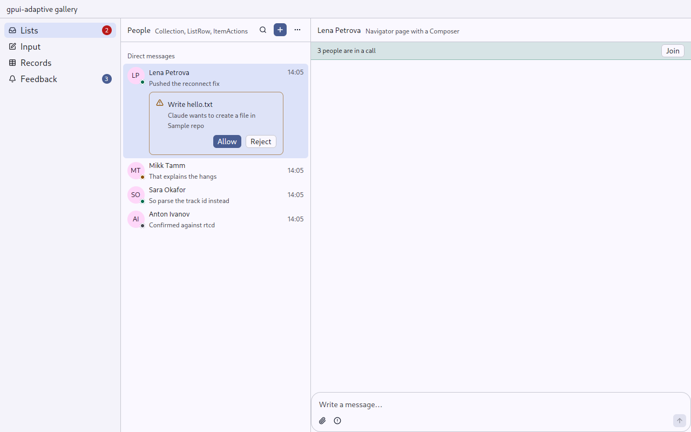
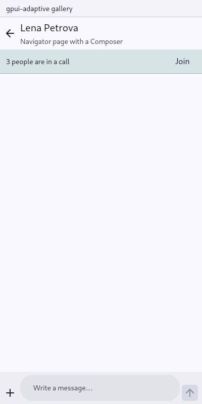
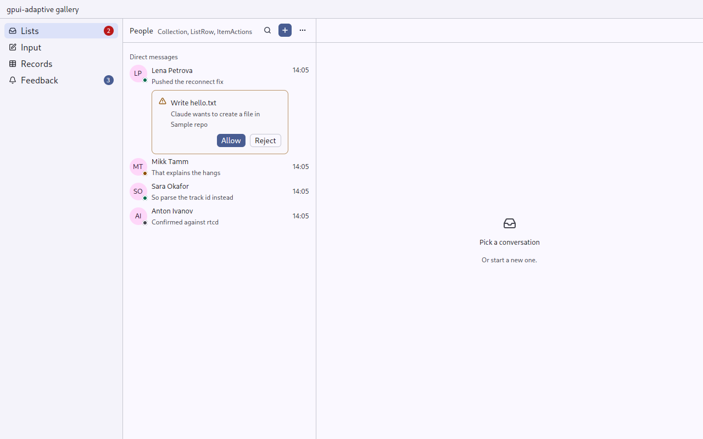
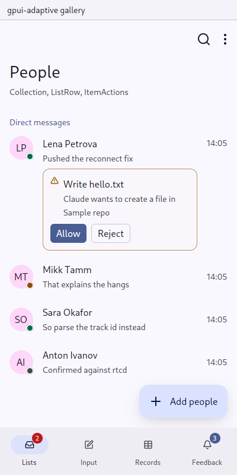

# Navigator: columns when there is room, a stack when not

`gpui_adaptive::navigator` · [index](../README.md)

The application describes its pages as `Route`s. A route may name its **companion**, the page shown beside it when the window is wide enough: a conversation's companion is the conversation list, and a record's is the records. matterfast's places (a list, a conversation, its thread; on a phone the list is the main screen, as in Telegram) and aiddiction's page stack are both this one intent.

| Window | What is shown |
|---|---|
| Expanded | the page and its companions beside it, up to three columns: a list, a conversation, its thread |
| Medium | up to two: the page and its companion |
| Compact | the top of the stack, with a way up. A page comes in sliding from the side (touch, 300 ms) or fading (pointer, 120 ms). |

The columns are found from the top down: the page, its companion, the companion's companion, as long as there is room. Columns have no way up. One column takes the room the others leave: the one whose route `grows()`, or the rightmost. The others are `Route::column_width()` wide (22 rem by default).

| Desktop: columns | Phone: stack |
|---|---|
|  |  |

## Beside a root page: `wide_detail`

When nothing else stands beside a page, `Route::wide_detail()` names what does, if there is room. Examples: the inbox's "Pick a conversation", or the first settings page beside the list of settings (aiddiction's `shell.rs:364`). On a compact window it is not shown, and back never goes to it. Make it a [Screen](screen.md) too, so that a page bar in the title bar has a page to be over.

| Desktop | Phone |
|---|---|
|  |  |

```rust
fn wide_detail(&self) -> Option<Self> {
    match self { Route::Inbox => Some(Route::NothingOpen), Route::Settings => Some(Route::Appearance), _ => None }
}
```

## Laid over the columns: `floats`

A route that `floats()` is laid over the right of its companion's columns, with a shadow, instead of taking a column: search results, glanced at and put away, should not push the conversation aside. On a compact window it is a page like any other. Its `Page::up()` closes it.

## Columns the person sizes: `resizable`

```rust
Navigator::new("places", &pages, render_page).resizable(
    |place, window_width, cx| width_of(place, window_width), // dragged, kept within reason, or a share
    |place, width, cx| store(place, width),                  // a drag; None after a double click
)
```

Every column that does not grow gets an edge to drag, on its side facing the one that grows; a floating page gets one on its left. A double click gives a column back its own width. matterfast keeps the widths with its settings.

## The application's state is the stack: `set_stack`

An application whose own state says what is open (a conversation, a thread over it) sets the stack from it: `navigator.set_stack(vec![List, Chat, Thread], cx)`. Nothing happens if it is already so; a longer stack with the same start comes in as a push, a shorter one as a pop. Back, a swipe and Up change the stack the other way; the application reads it back (`stack()`) or listens to `NavigatorEvent::Changed`.

`gesture_offset(window, cx)` is how far the page in front is moved aside by a gesture of back under way, for a UI scenario to check that it follows the finger.

## Back

While the navigator is a stack and back goes somewhere, it holds a `gpui_android_glue::back` layer:

- **The phone's back** (the button or the predictive gesture) pops the page. Partway through the gesture the page moves aside with the finger over the page it goes to (`back::preview`, with the page under drawn only while there is a gesture).
- **On a finger, a swipe to the right** anywhere across the page does the same (`swipe_back`), unless `Route::scrolls_sideways()` says the page has something that scrolls sideways (a diff, a board, a wide table).
- **Up** in the [Screen](screen.md) does the same.

`back()` pops the top. If only one page is left and it has a companion (opened straight onto a message), back goes to the companion.

## API

```rust
#[derive(Clone, PartialEq)]
enum Route { Channels, Channel(ChannelId), Thread(PostId) }

impl gpui_adaptive::Route for Route {
    fn companion(&self) -> Option<Self> {
        match self { Route::Channel(_) => Some(Route::Channels), _ => None }
    }
    fn scrolls_sideways(&self) -> bool { false }
}

let navigator = cx.new(|_| NavigatorState::new(Route::Channels));
navigator.update(cx, |n, cx| n.push(Route::Channel(id), cx));   // open
navigator.update(cx, |n, cx| n.replace_root(Route::Settings, cx)); // a destination
navigator.update(cx, |n, cx| n.back(cx));                         // -> bool
navigator.update(cx, |n, cx| n.retain(|r| r != &Route::Chat(closed), cx)); // a closed chat leaves the history

Navigator::new("pages", &navigator, |route, page, window, cx| match route {
    Route::Channels => channel_list(page, cx),
    Route::Channel(id) => Screen::new("channel", name(id)).page(&page).into_any_element(),
    ..
})
```

- `push` of the page already on top does nothing. Opening a sibling that has the same companion replaces the page beside it, so the list → A → B → back sequence returns to the list, not to A.
- `retain` keeps only the pages it is told to (aiddiction drops a closed conversation from the history). The first page stays if nothing else would.
- `NavigatorState` emits `NavigatorEvent::Changed` and is a plain stack: a UI scenario can start on any page.
- `render_page` may run for the page under the top while a gesture shows it, so it must not change anything.

## matterfast

`List → Chat → Thread | Search`: the list's `wide_detail` is the conversation, the conversation `grows`, search results `float`. On a wide window: list, conversation, thread; on a phone, each a page over the one it was opened from, back by the system's gesture, a swipe or Escape. A thread opened from the inbox is a page over the inbox: back goes there.

## Tests

- `navigator::tests`: back pops, then falls back to the companion; a sibling replaces the page beside its companion; `retain` drops closed pages and keeps a first one; as many columns as there is room for, from the top down; a floating page over its columns, a page on a phone; `set_stack` comes in as it changed.
- `tests/ui.rs`: `a_root_page_has_its_wide_detail_beside_it_only_where_there_is_room`.
- `tests/ui.rs`: `on_a_phone_a_message_is_a_page_over_the_inbox_and_up_goes_back` and `on_a_desktop_the_message_opens_beside_the_inbox`.
