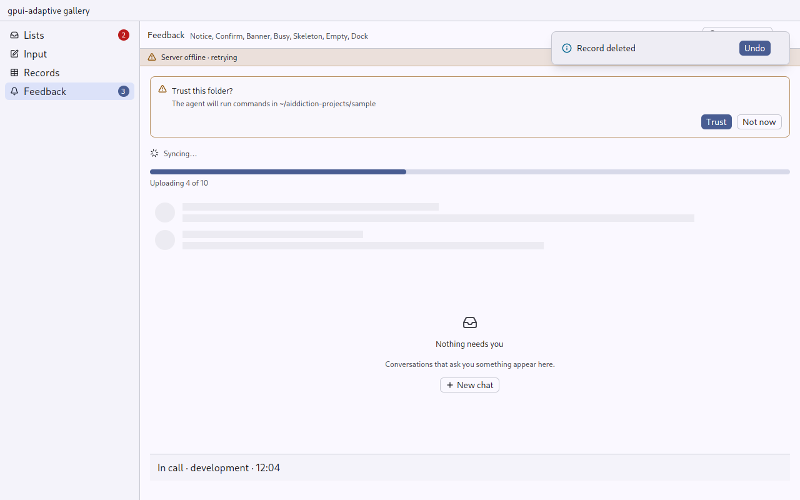
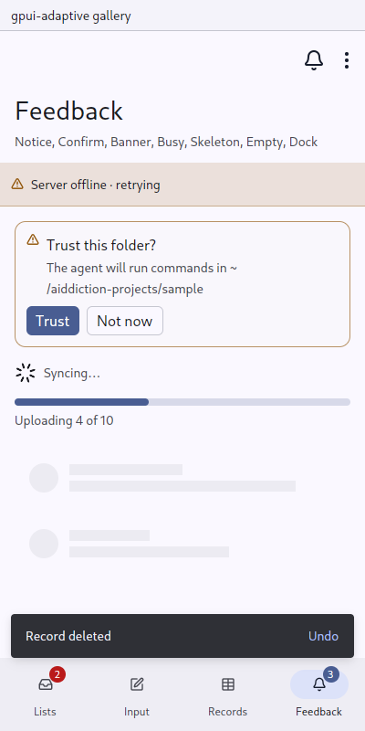
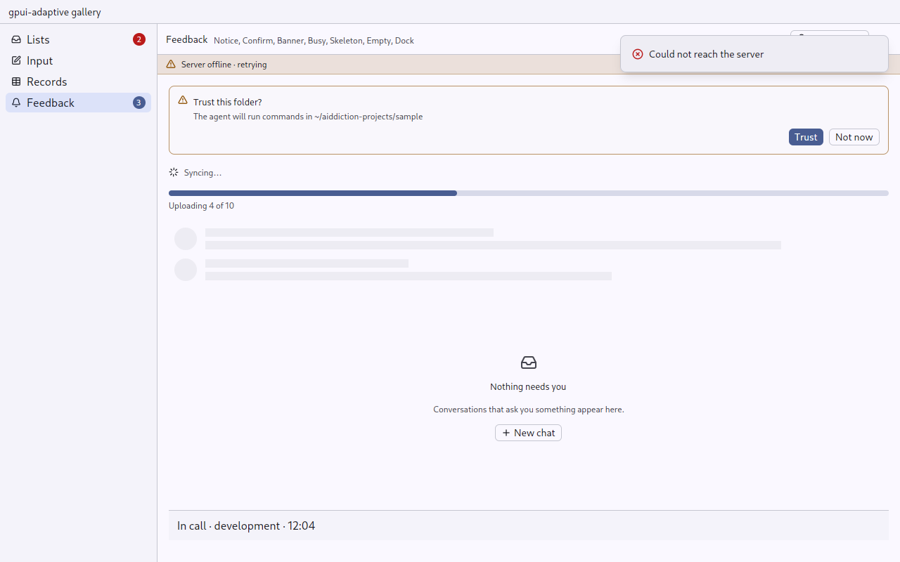
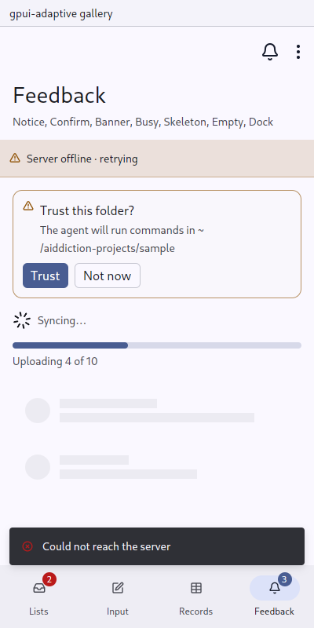

# Notice: a short message, with Undo

`gpui_adaptive::notice` · [index](../README.md)

A notice is a short message that goes away by itself, with at most one action, such as "Record deleted — Undo".

| Pointer | Touch |
|---|---|
| a gpui-kit notification at the window's corner; several stack; with an action it stays until dismissed or acted on | a Material snackbar on the inverse surface, above the navigation bar and the keyboard; one at a time, a new one replaces the one shown; gone after `Scale::notice` (4 s) |

| Pointer | Touch |
|---|---|
|  |  |

## API

```rust
Notice::new("Record deleted")
    .action("Undo", move |window, cx| restore(record, window, cx))
    .push(window, cx);
```

Choosing the action puts the notice away, then runs it.

```rust
Notice::error("Could not reach the server").push(window, cx);   // tone(Tone::Danger)
Notice::new("Saved").tone(Tone::Success).push(window, cx);
```

The tone picks the toolkit notification's type on a pointer, and an icon in the tone's colour on the touch snackbar (which stays on the inverse surface). Keep it `Info` unless the news is a failure or a warning.

| Pointer | Touch |
|---|---|
|  |  |

## When to use

- After a reversible action: delete, archive, move. Offer Undo instead of asking first.
- To confirm something that happened out of sight: "Saved for later", "Link copied".
- **Not** for a standing state, such as offline or a call in progress. That is a [Banner](banner.md).
- **Not** for errors the person has to act on in a form. Those go under the field ([TextField](text-field.md)).

## Built on

gpui-kit `Notification` and `WindowExt::push_notification` (pointer); the crate's snackbar layer drawn by [AppFrame](app-frame.md) (touch).
