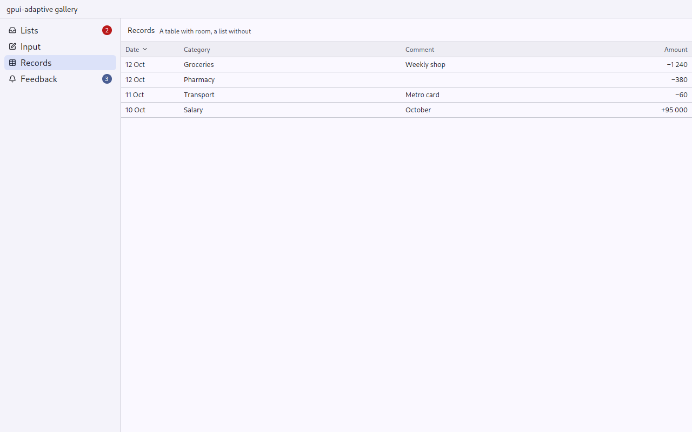
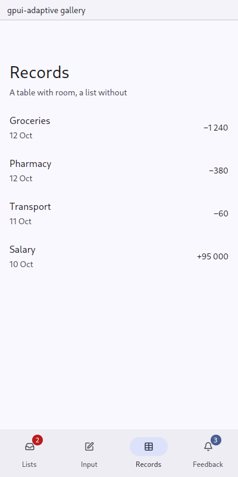

# Records: a table with room, a list without

`gpui_adaptive::records` · [index](../README.md)

`Records` shows rows of data with columns. It is money-manager's transactions, generalised.

| Pointer, Medium and up | Compact, or Touch |
|---|---|
| a table: a header row, numbers right-aligned in a medium weight, the selected row in the table's active colour; a sortable column sorts by a click on its header, with an arrow for the direction | a [ListRow](list.md) per record, built from the columns given the roles of title, subtitle and trailing |
| a record's [Tile](primitives.md) before the title cell | the tile leading the row |

| Pointer | Touch |
|---|---|
|  |  |

## API

```rust
Records::new("transactions")
    .column(Column::new("date", "Date").width(rems(6.)).sortable().role(ColumnRole::Subtitle))
    .column(Column::new("category", "Category").role(ColumnRole::Title))
    .column(Column::new("comment", "Comment"))                       // table only
    .column(Column::new("amount", "Amount").width(rems(7.)).numeric().role(ColumnRole::Trailing))
    .sorted_by("date", false)
    .selected(open.map(|id| ElementId::from(("record", id))))
    .records(rows.iter().map(|r| Record::new(("record", r.id), [r.date(), r.category(), r.comment(), r.amount()])))
    .on_sort(move |column, _, cx| this.update(cx, |this, cx| this.sort_by(column, cx)))
    .on_activate(move |id, window, cx| open_record(id, window, cx))
```

The owner sorts: it is told which column was pressed, keeps the order, and says which column it sorted by. The cells are strings the owner has already formatted, including number grouping and currency.

- `Column::grow(parts)` shares what the fixed columns leave by parts (the category 7, an id 3); without it each such column takes one part. `Column::muted()` draws a column in the secondary text colour (an id, a comment).
- `Record::tile(icon, color)` is what the record is of: a category's icon in its colour.
- `Record::pills([Pill])` are what the record is tagged with ([Pill](primitives.md)): in a table after the title cell's text, in a list row after the subtitle on its line. Neither grows for them; what does not fit is cut off at the row's end.
- `Records::fill(&scroll)` fills what holds it and scrolls by itself, laying out only the rows in view (a `uniform_list`): a ledger of years of records. Give the [Screen](screen.md) `scrolls(false)`. The owner keeps the `RecordsScroll` and brings a record into view with `scroll.scroll_to_item(ix, ScrollStrategy::Nearest)`, as the keyboard moves the selection. On a finger the list's scroll is locked to its axis.
- `Records::shared(Rc<Vec<Record>>)` takes records the owner keeps between frames.

money-manager's records: Up and Down move `selected`, Enter opens it, a press on a row opens it too.

## Tests

`tests/ui.rs`: `records_that_fill_the_page_lay_out_only_the_rows_in_view_in_both_skins` (a row in view is laid out, one far below is not, a press opens a row), `a_record_with_pills_is_as_tall_as_one_without_in_both_skins`.
