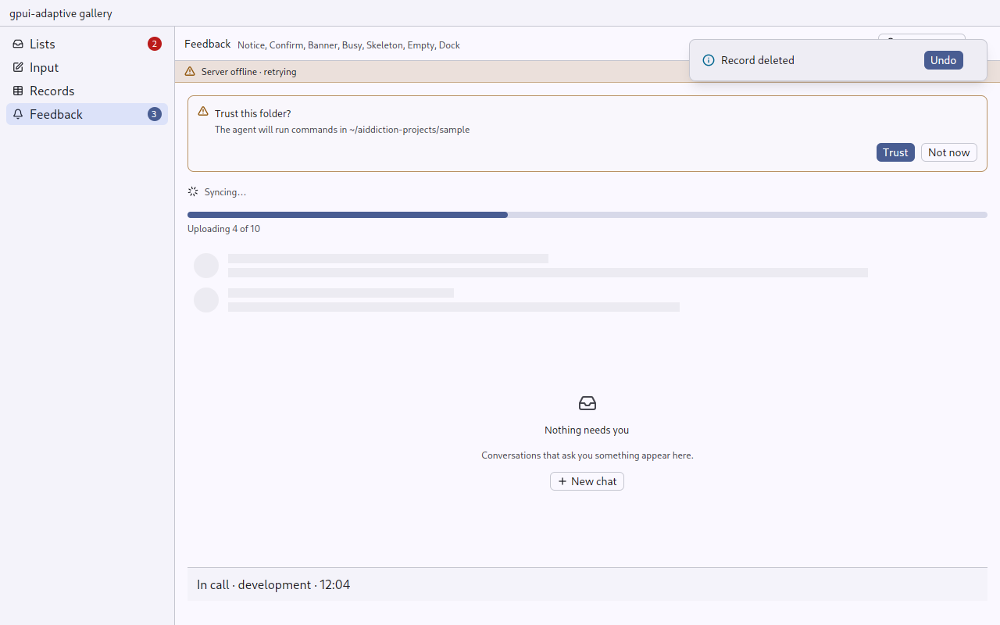
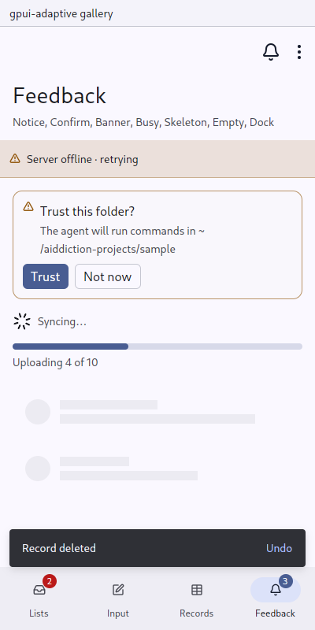

# Screen: a page with a title and commands

`gpui_adaptive::screen` · [index](../README.md)

`Screen` is a page: its title (and subtitle), the way up, its [commands](command.md), an optional [banner](banner.md), and its content in the page's one scroll area.

| Part | Pointer | Touch |
|---|---|---|
| Bar | a toolbar row; title and subtitle on one line | Material top app bar: title over subtitle |
| Root page | — | the large title with the bar's actions beside it on one centre line, no bar above; the subtitle and the switcher under it on the title's edge |
| Up | ← before the title, if the page has a way up | ← before the title |
| Commands | buttons with labels on an Expanded window, icon buttons with tooltips otherwise or in a column | at most two icons; the rest behind ⋮ in a sheet |
| Overflow and destructive | ⋯ dropdown menu with key bindings | in the ⋮ sheet, destructive last |
| Primary | the primary button at the end of the bar | a FAB in the content's corner, its icon alone; a press on it is its alone, never the row's under it |
| Content | `overflow_y_scrollbar()` | `overflow_y_scroll().lock_scroll_axis()` |

| Pointer | Touch |
|---|---|
|  |  |

## API

```rust
Screen::new("project", project.name())
    .subtitle(format!("{} tasks", tasks.len()))
    .page(&page)                           // up + column, from the Navigator
    .root(navigator.is_at_root())
    .command(Command::new("new-task", "New task").icon(IconName::Plus).primary().action(NewTask))
    .command(Command::new("review", "Review").icon(IconName::FileDiff).action(OpenReview))
    .command(Command::new("rename", "Rename…").overflow().action(Rename))
    .banner(offline.then(|| Banner::new("offline", "Server offline").tone(Tone::Warning)))
    .content(board)
```

- `.switcher(menu)` is what the page is about and the way to another: money-manager's account, a [Menu](menu.md) that is a `choice`. On a pointer it stands in the bar after the title; on a finger, under a root page's large title as a line of text with a caret on the title's edge (no outline: it is not a second heading), and in the app bar after the title otherwise.
- `.page(&page)` takes the way up and whether the page is a column from the [Navigator](navigator.md). `.up(Option<..>)` sets the way up by hand.
- `.in_title_bar(true)` draws the page's bar as the window's title bar, as aiddiction does: one row with the window controls, rather than a title bar with the page's bar under it. Use it with `AppFrame::title_bar(false)`. A page shown as a column keeps its bar in the column. A phone in the touch skin draws its page from the top of the window, the page's surface behind the status bar and its header under it, and a desktop preview of the touch skin gets an empty title bar for the window controls. On macOS the traffic lights sit at the left of the page's bar, not at the window's corner, when the page is beside a rail.
- `.status(Some(("Needs you".into(), Signal::Waiting(Tone::Warning))))` says what the page's subject is doing now. On a pointer it is a tinted pill after the title, with the signal's dot or spinner; on a finger it is not shown, since the page itself says it (the question's card, the stop button).
- In the title bar the bar is laid over the toolkit's title bar rather than inside it, so that a long subtitle is cut instead of pushing the window's controls out. A column beside such a page has its bar at the title bar's height, in its colours: one strip across the window.
- `.scrolls(false)` is for content that scrolls in its own way (a feed, a virtual list, a page with a composer at the bottom). The content then fills the page.
- Element ids: the primary command's id is its own (`"new-task"`), and the bar's buttons are `"up"` and `"more"`.

## Rules

- One primary command per page at most. It is the page's default commitment, not its most frequent action.
- Inside a Screen, do not nest another vertical scroll area of the same axis.

## Replaces

aiddiction `shell.rs` `render_screen` and `bar_actions`; money-manager `shell/chrome.rs`; matterfast's channel header.

## Tests

`tests/ui.rs`: `a_screen_can_be_the_window_title_bar`, `the_primary_command_is_a_button_that_runs_on_a_pointer`, `the_primary_command_is_a_fab_that_runs_on_a_phone`, `a_fab_over_a_row_takes_the_press_alone` and `a_switcher_is_on_the_page_in_both_skins`.
