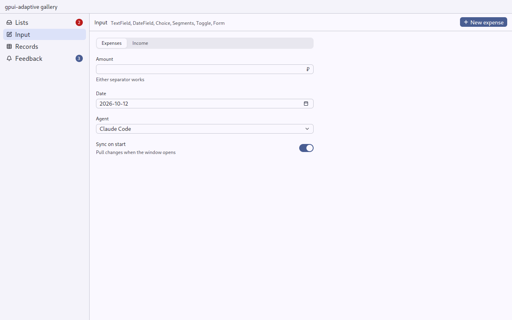
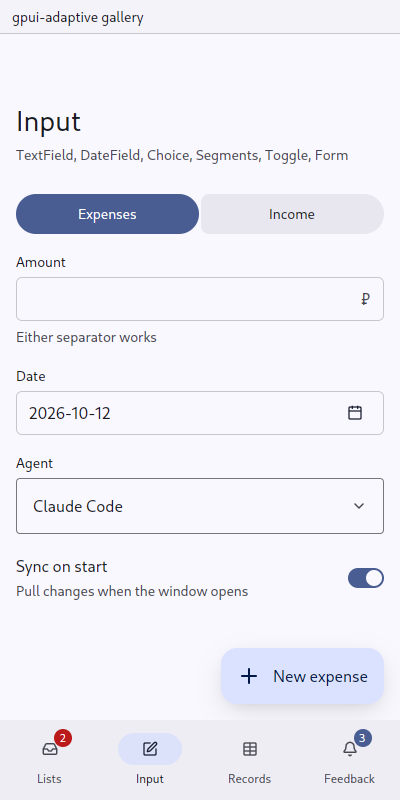

# Segments: two to four exclusive modes

`gpui_adaptive::segments` · [index](../README.md)

Use `Segments` for choices like Expenses or Income, Day or Week, Mentions or Saved.

| Pointer | Touch |
|---|---|
| gpui-kit's segmented look: a muted track with the chosen segment raised on it | Material 3's connected button group, 40 dp tall; the chosen segment is filled with the primary and fully rounded |

| Pointer | Touch |
|---|---|
|  |  |

## API

```rust
Segments::new("kind", self.kind.clone())
    .segment("expense", "Expenses")
    .segment_with_icon("income", "Income", IconName::ArrowDown)
    .on_change(move |key, _, cx| this.update(cx, |this, cx| { this.kind = key.clone(); cx.notify(); }))
```

The value is controlled: the owner keeps the selected key. `on_change` is not called for the segment already on. Each segment's element id is its key.

On a finger the group takes the width it is given and divides it among its segments: a switch that spans its page or card. `.fill(false)` makes it hug its segments instead, for a row where it stands beside something else (a card's title): a full width would leave the rest of the row nothing, and its text would break a letter to a line.

## When not to use

- More than four options, or options that are not all visible at once: use [Choice](choice.md).
- Navigating between sections: use [Destinations](destinations.md).
