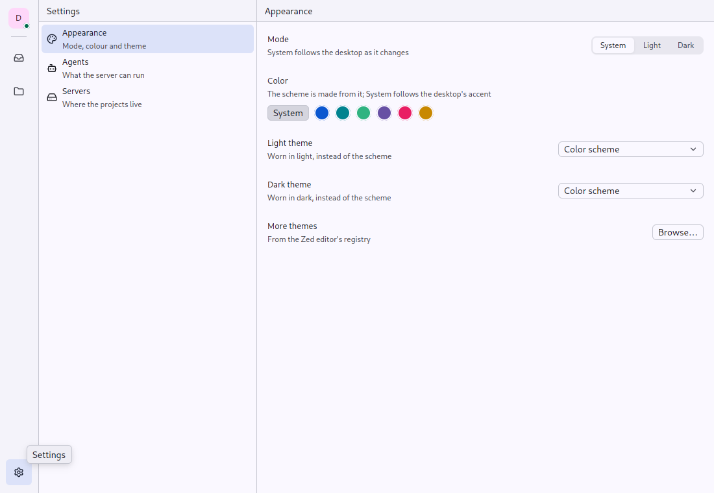

# Setting and Swatches: a settings page

`gpui_adaptive::setting` · [index](../README.md)

A settings page is a list of settings, each what it is beside what sets it. Every setting takes effect as it is chosen, so a settings page has no Save.

| | Pointer | Touch |
|---|---|---|
| `Setting` | title and a line of explanation on the left, the control on the right; under them where they do not fit | Material's settings item: the title in the body size, the explanation under it, at least a two-line row's height |
| `Swatches` | 24 px circles, a ring round the one picked, a tooltip with its name; "System" an outlined button | 40 dp circles; "System" a full-size button |



## API

```rust
Stack::new()
    .child(Setting::new("Mode").detail("System follows the desktop as it changes").control(modes))
    .child(
        Setting::new("Color")
            .detail("The scheme is made from it")
            .below(
                Swatches::new("colors", picked)            // Option<key>: none is the unset one
                    .unset("System")
                    .swatch("#0b57d0", "Blue", blue)
                    .on_pick(|key, _, cx| set_color(key, cx)),
            ),
    )
```

`control` goes beside the title; `below` takes the row's width (swatches, a theme browser).

## Tests

`tests/ui.rs`: `a_fold_a_swatch_and_a_pressable_answer_a_press_in_both_skins` picks a swatch by its key in both skins.
