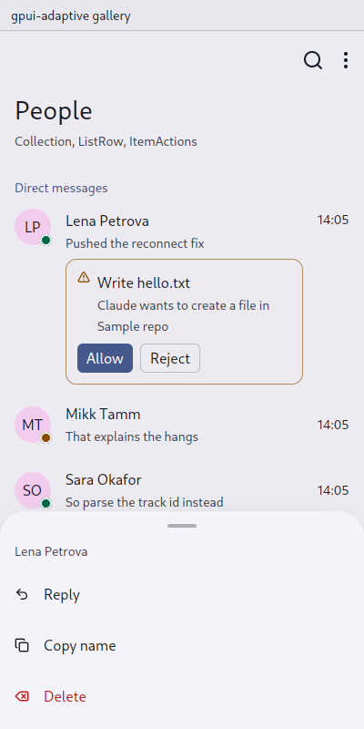
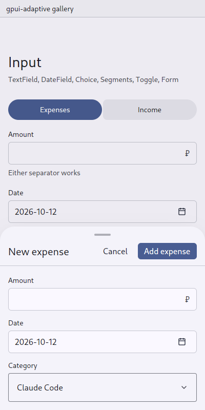
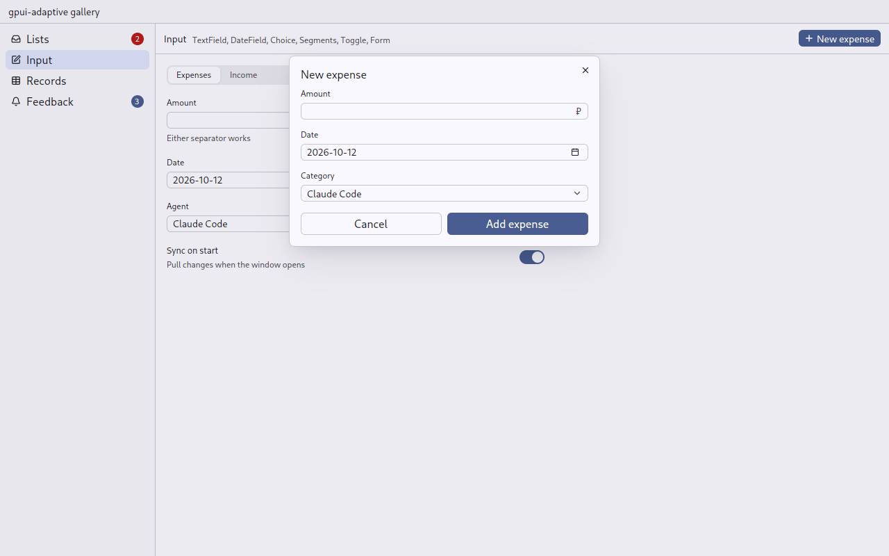

# Sheet: a short task or a set of choices over the page

`gpui_adaptive::sheet` · [index](../README.md)

| Pointer | Touch |
|---|---|
| the content in a gpui-kit dialog, opened through `gpui_android_glue::back::open_dialog` (so a tablet's back closes it) | a bottom sheet (money-manager's `bottom_sheet.rs`, generalised) |

| Touch: actions | Touch: form | Pointer: form |
|---|---|---|
|  |  |  |

## The touch sheet

- **Handle.** A handle across the top drags it, taken with `TouchDragEvent` (claimed with `prevent_default`) before it can become a scroll of the content. A mouse drags it too. Up makes it as tall as the window allows. Down past `PUT_AWAY_AT` (5 rem) puts it away. Short of that it settles back.
- **Closing.** The window is dimmed behind it, and a press on the dimmed part, Escape, or the phone's back closes it. Each sheet holds a `back::Guard`.
- **Stacking.** Sheets stack: a sheet opened from a sheet opens over it, and closing it uncovers the one under it as it was. The focus returns to what had it before.
- **Motion.** It opens, closes and settles over `Scale::sheet_*` by its height. The content is never rebuilt and keeps its state.
- **Room.** It stays above the keyboard and the navigation bar (`Insets::typing()`) and leaves 2 rem of the window above it.
- **Drawing.** Sheets are drawn by the window's [AppFrame](app-frame.md).

## API

```rust
Sheet::open(view, window, cx);            // any AnyView: it draws its own title and commitment
Sheet::close(window, cx);                 // the topmost sheet, or the dialog on a pointer
Sheet::is_open(window, cx);
Sheet::actions(Some("Lena Petrova".into()), commands, window, cx); // a list of commands
```

`Sheet::actions` is what a long press opens: one row per [command](command.md), destructive last. Choosing a row closes the sheet, then runs the command once the focus is back.

## Used by

[Form](form.md), [Choice](choice.md), [Lookup](lookup.md), [ItemActions](item-actions.md), [DateField](date-field.md) (its calendar on touch), [Screen](screen.md) (the ⋮ overflow), [Composer](composer.md) (the + tools).

## Tests

- `sheet::tests`: placement above and below the window; the motion curve.
- `tests/ui.rs`: `on_a_phone_a_choice_opens_a_sheet_and_choosing_closes_it` opens a sheet through the UI and waits for it to slide in.
