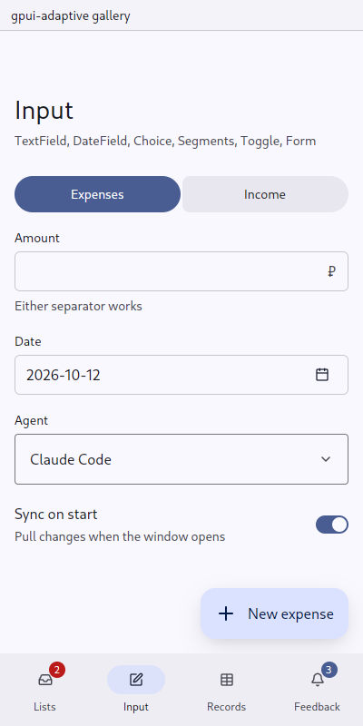

# TextField: a line of text, with a label, an error and a purpose

`gpui_adaptive::field` · [index](../README.md)

`TextField` is a line of text to type. It also covers amounts: the proposal's `Amount` is `TextFieldState::amount()` with a currency `suffix`.

| Pointer | Touch |
|---|---|
| gpui-kit `Input` at its small size, the label over it | the `Input` at its large size (a finger's height), the label over it |

Under the field: the error while there is one, otherwise the help line.



## Purpose

The field says what it is for with the glue's `Purpose`. On a phone, `keyboard::follow` shapes the keyboard from it, and `keyboard::on_tap` raises the keyboard even when the field kept its focus.

| Purpose | Keyboard |
|---|---|
| `Plain` | plain |
| `Message` | prose: capitals, corrections |
| `Address` | URLs, hosts |
| `Login` | a name or e-mail address to sign in with |
| `Password` | learns nothing; the field is masked |
| `Number` | digits with the decimal separator |

## API

```rust
// in the owner's new():
let amount = cx.new(|cx| TextFieldState::amount(window, cx));
let name = cx.new(|cx| TextFieldState::new(Purpose::Plain, window, cx));
cx.subscribe(&amount, |this, _, event: &FieldEvent, cx| match event {
    FieldEvent::Change => {}
    FieldEvent::Submit => {} // Enter, or the keyboard's action key
});

// in render():
TextField::new(&self.amount).label("Amount").suffix("₽").help("Either separator works")

// reading and validating:
let value = amount.read(cx).number(cx);          // reads "1 240,50", "1240.5", "-60"
amount.update(cx, |f, cx| f.set_error(Some("Type an amount"), cx));
```

Typing clears the error. `input()` exposes the inner gpui-kit `InputState` of a one-line field for anything beyond this.

- A `Password` field is masked, with an eye to look at it before it is sent.
- `TextFieldState::multiline(purpose, min, max, ..)` is a field of several lines growing from `min` to `max` (details in Markdown, an environment): Enter breaks the line.
- `TextFieldState::prompt(min, max, ..)` is what to ask, in a few lines (a conversation's first message): on a pointer Enter commits the form and Shift+Enter breaks the line; on a finger Enter breaks the line and the form's button commits.
- `set_placeholder` and `set_value` work on either.

## Tests

`field::tests` covers number parsing: either separator, spaces and no-break spaces between thousands, empty, and not a number.
